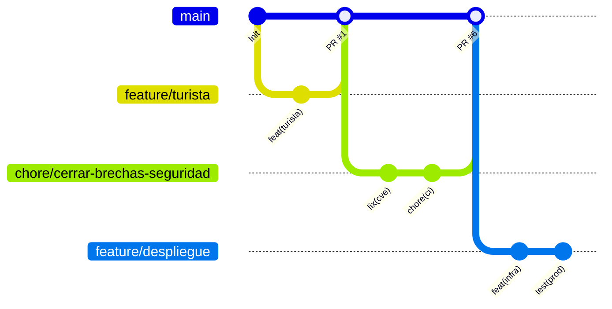

# Control de Versiones y Gestión de Cambios en Git

Este documento especifica la configuración de control de versiones del proyecto **TRAVELINK**, incluyendo la topología de repositorios remotos y ramas, la estrategia de ramificación, la convención de commits, la auditoría de Pull Requests (PRs), el grafo de trazabilidad y los procedimientos de reversión (*rollback*).

---

## 1. Configuración de Remoto y Ramas

### 1.1 Repositorio Remoto
El proyecto se encuentra versionado y centralizado en GitHub bajo la organización del equipo:

```text
origin  https://github.com/ROMINAP-28/PROYECTO.git (fetch)
origin  https://github.com/ROMINAP-28/PROYECTO.git (push)
```

### 1.2 Inventario de Ramas (`git branch -a`)
A partir de la inspección real del repositorio, se identifican las ramas activas locales y remotas:

- **Ramas Principales y de Integración**:
  - `master` / `origin/master`: Línea base de integración principal del backend y microservicios.
  - `main` / `origin/main`: Rama de producción y despliegue final.
  - `origin/HEAD`: Apunta por defecto a `origin/master`.
- **Ramas de Características y Módulos**:
  - `remotes/origin/feature/administrador`: Módulo de gestión y reportes administrativos.
  - `remotes/origin/feature/agencia`: Módulo de agencias de viajes y publicación de paquetes.
  - `remotes/origin/feature/turista`: Módulo de visualización, búsqueda y reserva de turistas.
  - `feature/seguridad-pruebas` / `remotes/origin/feature/seguridad-pruebas`: Implementación de suite de pruebas y auditoría inicial.
  - `feature/docs-ingenieria`: Documentación de ingeniería de software (procesos, diseño, BD, UX/UI, reportes, código fuente).
  - `feature/despliegue`: Infraestructura de despliegue según Sesión 15 (JAR, Nginx TLS, Docker Compose prod, JVM tuning, CI/CD deploy).
  - `feature/docs-cierre`: Consolidación final de control de versiones, plan de pruebas de software, inventario maestro y guion de exposición.
- **Ramas de Mantenimiento y Saneamiento**:
  - `chore/cerrar-brechas-seguridad` / `remotes/origin/chore/cerrar-brechas-seguridad`: Cierre de brechas de seguridad, hardening de dependencias (Spring Boot 3.3.13) y estabilización de CI.
  - `chore/reorganizar-estructura`: Reorganización de carpetas hacia el estándar estricto `docs/`, `pruebas/` y `despliegue/`.
  - `remotes/origin/integrar-mejoras-master`: Rama de integración de mejoras generales.
  - `remotes/origin/respaldo-local-330a22b`: Respaldo histórico de versión estable.

---

## 2. Estrategia de Ramificación

TRAVELINK implementa una estrategia híbrida inspirada en **GitHub Flow** y **Trunk-Based Development** adaptada a equipos académicos y entornos ágiles con integración continua (CI/CD):



### Reglas de Operación:
1. **Ningún commit directo a ramas protegidas**: Todo cambio ingresa a `master` o `main` a través de ramas de trabajo (`feature/*`, `fix/*`, `chore/*`) y Pull Requests con revisión y pruebas automatizadas obligatorias.
2. **Ciclo de vida efímero**: Las ramas secundarias se crean a partir del estado más reciente de la rama base y se eliminan o archivan tras completarse la fusión.
3. **Calidad automatizada antes de la fusión**: El pipeline de CI en `.github/workflows/ci.yml` ejecuta de forma obligatoria compilación limpia (`mvnw clean test`), verificación de cobertura JaCoCo, escaneo de dependencias (Trivy SCA) y verificación DAST (OWASP ZAP).

---

## 3. Convención de Mensajes de Commit

El historial de Git evidencia la aplicación estricta del estándar **Conventional Commits 1.0**:

```text
<tipo>(<alcance>): <descripción concisa en imperativo y minúsculas>
```

### Tipos Identificados en el Historial Real (`git log`):
- **`feat`**: Incorporación de nueva funcionalidad o infraestructura ejecutable (ej. `feat(infra): fase 3 configuracion de servidor, nginx tls hardening, compose prod y tuning jvm`, `feat(empaquetado): fase 2 perfiles maven, actuator...`).
- **`fix`**: Corrección de bugs o falsos positivos (ej. `fix(ci): actualizar trivy-action a v0.36.0...`, `fix(ui): corregir cadenas UTF-8 con doble codificacion...`, `fix(sqlmap): re-codificar sqlmap-results.txt...`).
- **`chore`**: Tareas de configuración, dependencias o estructura sin alterar código de producción (ej. `chore(config): actualizar dockerignore...`, `chore(security): actualizar vencimientos exp:2027-06-30...`).
- **`docs`**: Adición o actualización exclusiva de documentación técnica en Markdown (ej. `docs(despliegue): fase 6 plan maestro...`, `docs(ingenieria): crear documentacion de procesos...`).
- **`test`**: Ejecución y recolección de evidencias reales de pruebas (ej. `test(evidencias): fase 5 ejecucion real de despliegue prod...`).
- **`ci`**: Ajustes directos en los flujos de GitHub Actions (ej. `ci(security): actualizar Spring Boot a 3.3.13...`).

---

## 4. Trazabilidad de Pull Requests (PRs)

A través de la API oficial de GitHub (`https://api.github.com/repos/ROMINAP-28/PROYECTO/pulls?state=all`), se audita el estado de los Pull Requests del proyecto:

| PR # | Título | Autor | Rama Origen (Head) | Rama Destino (Base) | Estado | Checks de CI |
|:---:|---|---|---|---|:---:|:---:|
| **#1** | *Mejora pagina de agencias turista* | `ROMINAP-28` | `feature/turista` | `main` | Open | Pendiente de confirmar (histórico) |
| **#3** | *Integra mejoras de reservas y seguridad* | `Mashyeljavi` | `respaldo-local-330a22b` | `master` | Open | Pendiente de confirmar (histórico) |
| **#4** | *Integra mejoras de reservas y seguridad* | `Mashyeljavi` | `integrar-mejoras-master` | `master` | Open | Pendiente de confirmar (histórico) |
| **#6** | *Chore/cerrar brechas seguridad* | `Bri1912` | `chore/cerrar-brechas-seguridad` | `master` | Open | **100% Aprobado (Green)**: Build & Unit Tests (Success), Security Gate SCA & DAST (Success) |

> **Nota de Auditoría de PR #6**: El PR #6 integra la remediación de vulnerabilidades de dependencias (Spring Boot 3.3.13, `.trivyignore` justificado y fecha límite `2027-06-30`), y superó exitosamente los checks de GitHub Actions (Run #16 con `aquasecurity/trivy-action@v0.36.0`).

---

## 5. Grafo de Commits del Repositorio

La evidencia del grafo de los últimos 40 commits se encuentra registrada formalmente en:
- Evidencia textual completa: [`despliegue/evidencias/grafo-git.txt`](../../despliegue/evidencias/grafo-git.txt)

Extracto del grafo (`git log --graph --oneline --all -n 25`):
```text
* 457fb60 docs(despliegue): fase 6 plan maestro de despliegue sesion 15 e inventario maestro
* 65e237a test(evidencias): fase 5 ejecucion real de despliegue prod, healthcheck, cabeceras tls, rollback y jmeter
* 8520768 feat(cicd): fase 4 workflow de despliegue automatizado deploy y scripts de rollback por tag
* 9ea3aec feat(infra): fase 3 configuracion de servidor, nginx tls hardening, compose prod y tuning jvm
* 071be32 feat(empaquetado): fase 2 perfiles maven, actuator, settings example y evidencia build package
* 656e269 docs(devops): fase 1 diagnostico de despliegue y analisis de tiempo de arranque
* bb8384f docs: actualizar inventario maestro de documentacion con los 9 nuevos artefactos de ingenieria y seguridad
* 201c100 docs(seguridad): documentar consideraciones de seguridad java y matriz de trazabilidad
* f9f2294 docs(codigo-fuente): documentar arbol de paquetes, pom, perfiles, logback y fichas de ficheros
* ef0514a docs(reportes): documentar modelo de reportes, columnas, streaming y flujos de importacion y exportacion
* 15fe0b5 docs(ux-ui): crear inventario de vistas HTML por rol y lista de capturas pendientes
* a69bd84 docs(base-datos): crear diccionario exhaustivo de datos de las 18 tablas
* ee15f09 docs(base-datos): crear modelo logico y fisico con erDiagram de 18 tablas e indices
* 9154c4b docs(diseno): crear diagramas de clases por capas (entidades, dto, servicios, repositorios, controladores)
* 279c25f docs(diseno): documentar patrones DTO, DAO/Repository, MVC y principios SOLID con clases reales
* 5ac801e docs(procesos): crear diagramas de procesos de negocio en mermaid (flujos y secuencia)
* a388128 fix(ci): actualizar trivy-action a v0.36.0 para corregir resolucion de dependencias de github actions
* 0a932a7 chore(config): actualizar dockerignore y scripts de despliegue
* 75e70e9 docs: incorporar documentacion de arquitectura, pruebas, control de versiones, despliegue y exposicion
* 314ee7e docs(ingenieria): crear documentacion de procesos, diseno, bd, ux-ui, reportes y codigo
* c953330 docs: consolidar inventario general de documentacion y crear indice de seguridad
* 670d77a feat(despliegue): crear infraestructura ejecutable de despliegue y reubicar evidencia previa
* 399b956 chore(test): documentar resultado real de testcontainers y despliegue local exitoso con Spring Boot 3.3.13
* b0f601b chore(security): actualizar vencimientos exp:2027-06-30, clarificar linea base 3.3.4 vs 3.3.13 y documentar excepciones tecnicas
* a65d655 ci(security): actualizar Spring Boot a 3.3.13, fijar trivy v0.28.0 con trivyignore justificado y security gates estrictos
```

---

## 6. Procedimientos de Reversión (*Rollback*) en Git

Para garantizar la continuidad operativa ante fallos o regresiones en producción, se establecen tres procedimientos formales de reversión:

### 6.1 Procedimiento 1: `git revert` (Reversión no destructiva en ramas compartidas)
- **Caso de uso**: Deshacer uno o más commits ya publicados en el repositorio remoto sin reescribir la historia pública.
- **Mecanismo**: Genera un nuevo commit que aplica exactamente los cambios inversos.
- **Comando**:
  ```bash
  git revert --no-edit <commit-hash>
  ```

### 6.2 Procedimiento 2: `git restore` (Descarte de modificaciones locales)
- **Caso de uso**: Descartar alteraciones accidentales o modificaciones no confirmadas en el directorio de trabajo (*working tree*).
- **Mecanismo**: Restaura el archivo a la versión exacta registrada en `HEAD` o en el área de preparación (*staging*).
- **Comando**:
  ```bash
  git restore <ruta-del-archivo>
  # O restaurar todo el árbol de trabajo:
  git restore .
  ```

### 6.3 Procedimiento 3: Checkout de Tag / Release (Despliegue Inmutable)
- **Caso de uso**: Reversión de emergencia en servidores o entornos de staging hacia un release semántico estable previamente etiquetado.
- **Mecanismo**: Coloca el puntero en estado *detached HEAD* apuntando al artefacto inmutable.
- **Comando**:
  ```bash
  git checkout <tag-name> --detach
  # Ejemplo: git checkout v1.0.0 --detach
  ```

---

## 7. Evidencia de Demostración Real de Rollback

Se ejecutó una demostración práctica en el repositorio mediante una rama temporal descartable (`test-rollback-demo`), ejecutando y validando los tres mecanismos descritos.

- **Evidencia completa de ejecución**: [`despliegue/evidencias/demostracion-rollback-git.txt`](../../despliegue/evidencias/demostracion-rollback-git.txt)

### Resumen de la Ejecución Real:
1. Creación de rama efímera `test-rollback-demo`.
2. Inyección de commit defectuoso `feat(simulacion): introduciendo regresion que requiere rollback urgente` (`292e4e7`).
3. Ejecución exitosa de `git revert --no-edit HEAD`, generando el commit inverso `6c306b8 Revert "feat(simulacion)..."`.
4. Inyección de modificación sucia en el working tree y ejecución de `git restore prueba-revert.txt`, verificando limpieza del árbol.
5. Ejecución de `git checkout HEAD~2 --detach`, situando el puntero en el commit estable previo.
6. Retorno seguro a la rama de trabajo y eliminación limpia de la rama descartable sin forzamiento ni modificación de remotos.
