# Guion de Exposición y Sustentación Técnica del Proyecto TRAVELINK 🎤

Este documento contiene la planificación detallada de la defensa técnica del proyecto **TRAVELINK**, estructurada en **14 diapositivas ejecutivas** y un **guion de demostración práctica en vivo (*live demo*)**, mapeando cada requerimiento a sus evidencias verificables en el repositorio.

---

## 1. Estructura de Diapositivas (14 Diapositivas)

```mermaid
flowchart LR
    S1["1. Portada y Visión"] --> S2["2. Problemática y Objetivos"]
    S2 --> S3["3. Arquitectura y Stack"]
    S3 --> S4["4. Modelo de Datos y BD"]
    S4 --> S5["5. Backend y Servicios"]
    S5 --> S6["6. Frontend y UX/UI"]
    S6 --> S7["7. Reportes y Streaming"]
    S7 --> S8["8. Control de Versiones"]
    S8 --> S9["9. Pruebas Unitarias y JaCoCo"]
    S9 --> S10["10. Pruebas de Integración"]
    S10 --> S11["11. Seguridad DAST y SCA"]
    S11 --> S12["12. Rendimiento (JMeter)"]
    S12 --> S13["13. Despliegue y Nginx TLS"]
    S13 --> S14["14. Conclusiones y Logros"]
```

---

### Diapositiva 1: Portada y Presentación del Proyecto
- **Título**: TRAVELINK — Plataforma de Gestión y Comercialización de Experiencias Turísticas
- **Subtítulo**: Arquitectura Empresarial, Pruebas Automatizadas, Hardening de Seguridad y Despliegue Continuo
- **Equipo y Roles**:
  - Briane Dayana Infantes Gonzales (DevOps & Security Engineer)
  - Romina Palacios (Frontend & UX/UI Lead)
  - Mashyel Javier (Backend & Database Architect)
- **Evidencia del Repo a Mencionar**:
  - [`README.md`](../../README.md)
  - [`docs/INVENTARIO_DOCUMENTACION.md`](../INVENTARIO_DOCUMENTACION.md)

---

### Diapositiva 2: Problemática y Procesos de Negocio
- **Contenido**:
  - Desafío: Centralizar la oferta turística formal entre agencias certificadas y turistas, gestionando reservas concurrentes y cálculo de comisiones transparentes (15%).
  - Flujos modelados: Registro y validación de RUC de agencias, publicación de tours, reservas con control de cupos y liquidación administrativa.
- **Evidencia del Repo**:
  - Procesos documentados: [`docs/ingenieria/procesos/PROCESOS_NEGOCIO.md`](../ingenieria/procesos/PROCESOS_NEGOCIO.md)
  - Diagramas de flujo y secuencia Mermaid: [`docs/ingenieria/procesos/DIAGRAMAS_PROCESOS.md`](../ingenieria/procesos/DIAGRAMAS_PROCESOS.md)

---

### Diapositiva 3: Arquitectura del Sistema y Stack Tecnológico
- **Contenido**:
  - Patrón Arquitectural: MVC desacoplado con controladores REST, inyección de dependencias y servicios transaccionales.
  - Stack: Java 21 LTS, Spring Boot 3.3.13, Spring Security 6.3, Spring Data JPA / JDBC Nativo, MySQL 8.0, Docker, Nginx TLS.
- **Evidencia del Repo**:
  - Especificación de arquitectura: [`docs/arquitectura/ARQUITECTURA.md`](../arquitectura/ARQUITECTURA.md)
  - Configuración y dependencias auditadas: [`pom.xml`](../../pom.xml) y [`Springboot/resources/application.properties`](../../Springboot/resources/application.properties)

---

### Diapositiva 4: Modelo de Datos y Persistencia
- **Contenido**:
  - Esquema Relacional: 18 tablas en tercera forma normal (3FN) con integridad referencial estricta y cascadas controladas.
  - Entidades centrales: `Usuario`, `Rol`, `Agencia`, `Tour`, `TourFecha`, `Reserva`, `DetalleReserva`, `Pago`, `Comision`.
- **Evidencia del Repo**:
  - DDL de base de datos: [`sql/travelink_schema.sql`](../../sql/travelink_schema.sql)
  - Modelo lógico y físico con ERD: [`docs/ingenieria/base-datos/MODELO_LOGICO_FISICO.md`](../ingenieria/base-datos/MODELO_LOGICO_FISICO.md)
  - Diccionario exhaustivo: [`docs/ingenieria/base-datos/DICCIONARIO_DATOS.md`](../ingenieria/base-datos/DICCIONARIO_DATOS.md)

---

### Diapositiva 5: Backend y Lógica de Negocio
- **Contenido**:
  - Capas de software: Controladores REST (`@RestController` y handlers dedicados por rol), Servicios con interfaces desacopladas, Repositorios Spring Data y DAOs JDBC.
  - Principios SOLID aplicados: Responsabilidad única en validación de cupos y comisiones; inyección de dependencias.
- **Evidencia del Repo**:
  - Código fuente Java: [`Springboot/src/com/travelink/servicio/`](../../Springboot/src/com/travelink/servicio/)
  - Patrones documentados: [`docs/ingenieria/diseno/PATRONES.md`](../ingenieria/diseno/PATRONES.md)
  - Diagrama de clases: [`docs/ingenieria/diseno/DIAGRAMA_CLASES.md`](../ingenieria/diseno/DIAGRAMA_CLASES.md)

---

### Diapositiva 6: Frontend, UX/UI y Experiencia de Usuario
- **Contenido**:
  - Arquitectura Frontend: 34 páginas HTML5 semánticas organizadas por roles (`publico`, `turista`, `agencia`, `administrador`).
  - Tecnologías: Vanilla JavaScript con Fetch API asíncrona, estilos CSS3 modulares y diseño responsivo para móviles y escritorio.
- **Evidencia del Repo**:
  - Inventario de interfaces y pantallas: [`docs/ingenieria/ux-ui/PROTOTIPOS.md`](../ingenieria/ux-ui/PROTOTIPOS.md)
  - Vistas estáticas: [`Springboot/resources/static/html/`](../../Springboot/resources/static/html/)
  - Guía de estilos: [`docs/ingenieria/ux-ui/GUIA_ESTILOS_UX.md`](../ingenieria/ux-ui/GUIA_ESTILOS_UX.md)

---

### Diapositiva 7: Motor de Reportes y Exportación Masiva
- **Contenido**:
  - Generación de PDF: Exportación de vouchers y comprobantes con OpenPDF.
  - Generación de Excel: Streaming de reportes de comisiones y reservas de alto volumen con Apache POI (`SXSSFWorkbook`), evitando fugas de memoria en la JVM.
- **Evidencia del Repo**:
  - Implementación Java: [`Springboot/src/com/travelink/reportes/ExcelReporteService.java`](../../Springboot/src/com/travelink/reportes/ExcelReporteService.java)
  - Especificación de columnas y streaming: [`docs/ingenieria/reportes/MODELO_REPORTES.md`](../ingenieria/reportes/MODELO_REPORTES.md)

---

### Diapositiva 8: Control de Versiones y Trabajo Colaborativo en Git
- **Contenido**:
  - Estrategia de Ramas: GitHub Flow / Trunk-Based con branches protegidas y Pull Requests obligatorios.
  - Trazabilidad y Calidad: Convención Conventional Commits 1.0, 4 Pull Requests auditados (#1, #3, #4 y #6 aprobado en CI).
  - Procedimientos de Rollback: Pruebas reales de reversión mediante `git revert`, `git restore` y `git checkout tag`.
- **Evidencia del Repo**:
  - Documentación de ramas y PRs: [`docs/control-versiones/CONTROL_VERSIONES.md`](../control-versiones/CONTROL_VERSIONES.md)
  - Grafo de confirmaciones: [`despliegue/evidencias/grafo-git.txt`](../../despliegue/evidencias/grafo-git.txt)
  - Evidencia real de rollback: [`despliegue/evidencias/demostracion-rollback-git.txt`](../../despliegue/evidencias/demostracion-rollback-git.txt)

---

### Diapositiva 9: Pruebas Unitarias y Cobertura JaCoCo
- **Contenido**:
  - Suite de Pruebas: 20 pruebas unitarias con JUnit 5 y Mockito para servicios de reservas, cancelaciones, calificaciones, comisiones y autenticación.
  - Resultado: **100% de éxito (0 fallos, 0 errores)** en 33 segundos.
  - Cobertura de Código: Métricas auditadas con JaCoCo en controladores y modelos de negocio.
- **Evidencia del Repo**:
  - Plan de pruebas: [`docs/pruebas-software/PLAN_PRUEBAS_SOFTWARE.md`](../pruebas-software/PLAN_PRUEBAS_SOFTWARE.md)
  - Código de pruebas: [`Springboot/test/com/travelink/servicio/`](../../Springboot/test/com/travelink/servicio/)
  - Reporte JaCoCo generado: `target/site/jacoco/index.html`

---

### Diapositiva 10: Pruebas de Integración y Persistencia (Testcontainers)
- **Contenido**:
  - Arquitectura de Integración: Contenedores efímeros Docker MySQL 8.0 gestionados por Testcontainers en `ReservaPersistenciaIntegracionTest`.
  - Validación de Concurrencia: Verificación de transacciones ACID y bloqueo de reservas concurrentes sin colisiones de stock.
- **Evidencia del Repo**:
  - Clase de prueba: [`Springboot/test/com/travelink/integracion/ReservaPersistenciaIntegracionTest.java`](../../Springboot/test/com/travelink/integracion/ReservaPersistenciaIntegracionTest.java)
  - Evidencia de ejecución: [`pruebas/evidencias/integracion-testcontainers.txt`](../../pruebas/evidencias/integracion-testcontainers.txt)

---

### Diapositiva 11: Auditoría de Seguridad (SCA, DAST y Hardening)
- **Contenido**:
  - SCA (Trivy): Hardening de dependencias actualizadas a Spring Boot 3.3.13; `.trivyignore` formalmente documentado con expiración `2027-06-30`.
  - DAST (OWASP ZAP): Escaneo dinámico con triaje de alertas y validación de falsos positivos.
  - Inyección y Fuzzing: Pruebas automatizadas con SQLMap y análisis de resiliencia con FFUF.
- **Evidencia del Repo**:
  - Informe final de seguridad: [`docs/seguridad/05-informe/INFORME_FINAL.md`](../seguridad/05-informe/INFORME_FINAL.md)
  - Catálogo de dependencias CVE: [`docs/seguridad/02-analisis/tabla-dependencias-cve.md`](../seguridad/02-analisis/tabla-dependencias-cve.md)
  - Pipeline de CI seguro: [`.github/workflows/ci.yml`](../../.github/workflows/ci.yml)

---

### Diapositiva 12: Pruebas de Rendimiento y Carga (Apache JMeter)
- **Contenido**:
  - Escenario de Carga: 100 a 200 usuarios concurrentes simulando navegación, consulta de destinos y reservas.
  - Resultados: Tasa de error del 0.00%, latencia promedio de 118 ms, percentil 95 < 240 ms, demostrando estabilidad del pool HikariCP.
- **Evidencia del Repo**:
  - Script JMeter: [`pruebas/rendimiento/jmeter/travelink.jmx`](../../pruebas/rendimiento/jmeter/travelink.jmx)
  - Evidencias de carga: [`despliegue/evidencias/jmeter/resumen-jmeter-prod.txt`](../../despliegue/evidencias/jmeter/resumen-jmeter-prod.txt)

---

### Diapositiva 13: Despliegue en Producción y Hardening de Servidor
- **Contenido**:
  - Empaquetado Fat JAR con Tomcat embebido vs WAR tradicional.
  - Nginx Reverse Proxy: Terminación TLS, cabeceras HSTS, CSP estricto, atributos de cookie `Secure; SameSite=Lax`, bloqueo de panel administrativo por IP.
  - Docker Compose Prod: Puertos privados (8080 no expuesto al anfitrión), límites de memoria y tuning de JVM (G1GC, `-Xms512m -Xmx1024m`).
  - Monitoreo con Spring Boot Actuator (`/actuator/health`).
- **Evidencia del Repo**:
  - Plan de despliegue: [`docs/despliegue/PLAN_DESPLIEGUE.md`](../despliegue/PLAN_DESPLIEGUE.md)
  - Configuración Nginx: [`despliegue/servidor/nginx/travelink.conf`](../../despliegue/servidor/nginx/travelink.conf)
  - Orquestación prod: [`despliegue/docker/docker-compose.prod.yml`](../../despliegue/docker/docker-compose.prod.yml)
  - Evidencia de cabeceras reales: [`despliegue/evidencias/cabeceras-despues-tls.txt`](../../despliegue/evidencias/cabeceras-despues-tls.txt)

---

### Diapositiva 14: Conclusiones y Cumplimiento de la Rúbrica
- **Contenido**:
  - Cumplimiento Integral: 105/100 puntos en rúbrica académica con bonificación de pruebas de carga JMeter.
  - Robustez demostrada: Pipeline CI/CD automatizado, suite de pruebas en verde y despliegue inmutable con rollback automatizado.
- **Evidencia del Repo**:
  - Rúbrica oficial: [`docs/seguridad/05-informe/CHECKLIST_RUBRICA.md`](../seguridad/05-informe/CHECKLIST_RUBRICA.md)
  - Inventario maestro: [`docs/INVENTARIO_DOCUMENTACION.md`](../INVENTARIO_DOCUMENTACION.md)

---

## 2. Guion de Demostración Práctica en Vivo (*Live Demo*)

| Minuto | Etapa de la Demo | Acción Técnica a Realizar | Endpoint / Comando Ejecutado | Evidencia en Pantalla |
|:---:|---|---|---|---|
| **00:00 - 02:00** | **1. Despliegue y Salud** | Verificar los contenedores activos de producción y el healthcheck de Spring Boot Actuator. | `docker compose -f despliegue/docker/docker-compose.prod.yml ps` `curl -k https://localhost/actuator/health` | Salida con `nginx`, `app` y `db` en estado `(healthy)` y JSON `{"status":"UP"}`. |
| **02:00 - 04:00** | **2. Navegación y Frontend** | Abrir navegador en `https://localhost` (o `http://localhost:8080`), mostrar catálogo público de destinos y detalle de tour. | GET `/html/index.html` GET `/api/destinos` | Interfaz responsiva cargando destinos desde base de datos vía Fetch API. |
| **04:00 - 06:00** | **3. Flujo Transaccional** | Iniciar sesión como turista, seleccionar fecha disponible, registrar pasajeros y reservar. | POST `/api/auth/login` POST `/api/guardar_reserva` | Reserva generada en BD, confirmación en pantalla y cupos actualizados. |
| **06:00 - 07:30** | **4. Administración y Reportes** | Acceder como administrador, visualizar panel de comisiones y descargar reporte en Excel generado por streaming. | GET `/html/administrador/comisiones.html` GET `/api/admin/reportes/excel` | Archivo `.xlsx` generado con POI conteniendo desglose de comisiones del 15%. |
| **07:30 - 09:00** | **5. Seguridad Perimetral** | Demostrar cabeceras HTTPS y bloqueo de endpoints administrativos en Nginx. | `curl -k -I https://localhost/api/destinos` | Cabeceras HSTS (`max-age=31536000`), CSP y cookies `Secure; SameSite=Lax`. |
| **09:00 - 10:00** | **6. CI/CD y Calidad** | Mostrar la ejecución aprobada de GitHub Actions y suite de pruebas unitarias. | `./mvnw -B test` Navegador en GitHub PR #6 | 20 pruebas unitarias en verde y Security Gate exitoso en GitHub Actions. |
