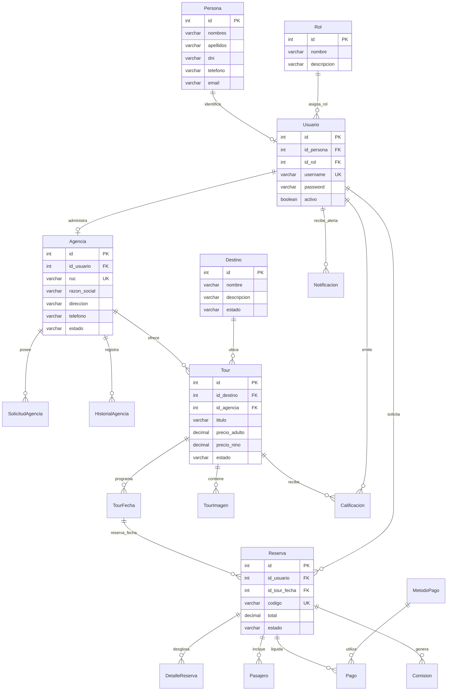

# Modelo de Datos y Diccionario Relacional — TRAVELINK 🗄️

La base de datos relacional de **TRAVELINK** está implementada sobre **MySQL 8.0** con cotejamiento UTF-8 multilingüe (`utf8mb4_unicode_ci`) y motor transaccional `InnoDB`.

---

## 1. Diagrama Entidad - Relación (ERD)

---

## 2. Catálogo y Diccionario de Tablas (18 Tablas)

| # | Tabla | Propósito Operacional | Clave Primaria | Claves Foráneas Principales |
|---|---|---|:---:|---|
| 1 | `Rol` | Catálogo de roles del sistema (TURISTA=1, AGENCIA=2, ADMIN=3) | `id` | Ninguna |
| 2 | `Persona` | Datos de filiación ciudadana (DNI, nombres, apellidos, teléfono, email) | `id` | Ninguna |
| 3 | `Usuario` | Credenciales de acceso, rol asignado, estado activo y bloqueo | `id` | `id_persona`, `id_rol` |
| 4 | `Agencia` | Perfil corporativo de agencia de viajes, RUC (11 dígitos) y estado | `id` | `id_usuario` |
| 5 | `SolicitudAgencia` | Historial de solicitudes de afiliación para revisión administrativa | `id` | `id_agencia`, `id_admin` |
| 6 | `HistorialAgencia` | Bitácora de cambios de estado y observaciones de agencias | `id` | `id_agencia` |
| 7 | `Destino` | Catálogo de regiones y ciudades turísticas (Cusco, Lima, etc.) | `id` | Ninguna |
| 8 | `Tour` | Paquete turístico ofrecido por una agencia en un destino específico | `id` | `id_destino`, `id_agencia` |
| 9 | `TourFecha` | Disponibilidad programada: fecha de salida, cupo máximo y cupos disponibles | `id` | `id_tour` |
| 10 | `TourImagen` | Galería multimedia de fotografías asociadas a cada tour | `id` | `id_tour` |
| 11 | `Reserva` | Transacción de reserva: código único, fecha, total y estado | `id` | `id_usuario`, `id_tour_fecha` |
| 12 | `DetalleReserva` | Desglose económico por tipo de tarifa (adultos, niños, infantes) | `id` | `id_reserva` |
| 13 | `Pasajero` | Manifiesto de viajeros con DNI, nombres y edad vinculados a la reserva | `id` | `id_reserva` |
| 14 | `MetodoPago` | Catálogo de pasarelas y métodos habilitados (Tarjeta, Transferencia, Yape) | `id` | Ninguna |
| 15 | `Pago` | Registro de transacciones monetarias, comprobante y código de operación | `id` | `id_reserva`, `id_metodo_pago` |
| 16 | `Calificacion` | Reseñas, puntuación en estrellas (1-5), comentario y estado de moderación | `id` | `id_usuario`, `id_tour` |
| 17 | `Comision` | Registro contable de comisión de plataforma (15%) y liquidación a agencia | `id` | `id_reserva`, `id_agencia` |
| 18 | `Notificacion` | Alertas de eventos del sistema (confirmaciones, cancelaciones, avisos) | `id` | `id_usuario` |

---

## 3. Integridad Referencial y Estrategia de Índices

- **Restricciones de Unicidad (`UNIQUE KEY`):**
  - `Usuario.username`: Garantiza cuentas unívocas por usuario.
  - `Agencia.ruc`: Restringe un solo registro por identificador tributario SUNAT.
  - `Reserva.codigo`: Código alfanumérico único para identificación de voucher.
- **Acciones en Cascada:**
  - Las relaciones críticas (e.g. `Reserva` con `DetalleReserva` y `Pasajero`) manejan integridad referencial controlada para prevenir registros huérfanos.
- **Optimización de Índices:**
  - Al iniciar la aplicación, `TravelinkApplication` ejecuta un procedimiento de verificación automática creando índices en columnas de búsqueda recurrente (`id_destino`, `id_agencia`, `id_usuario`, `fecha_salida`).
