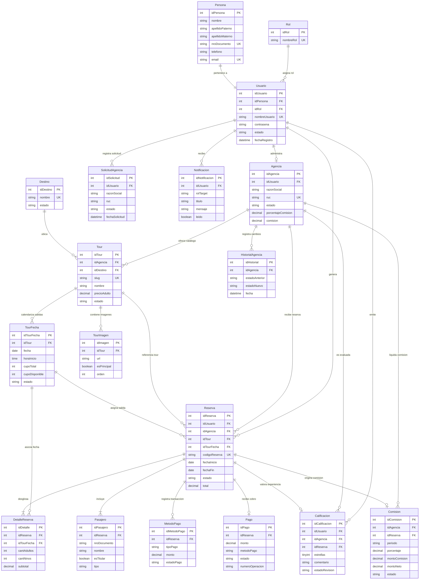
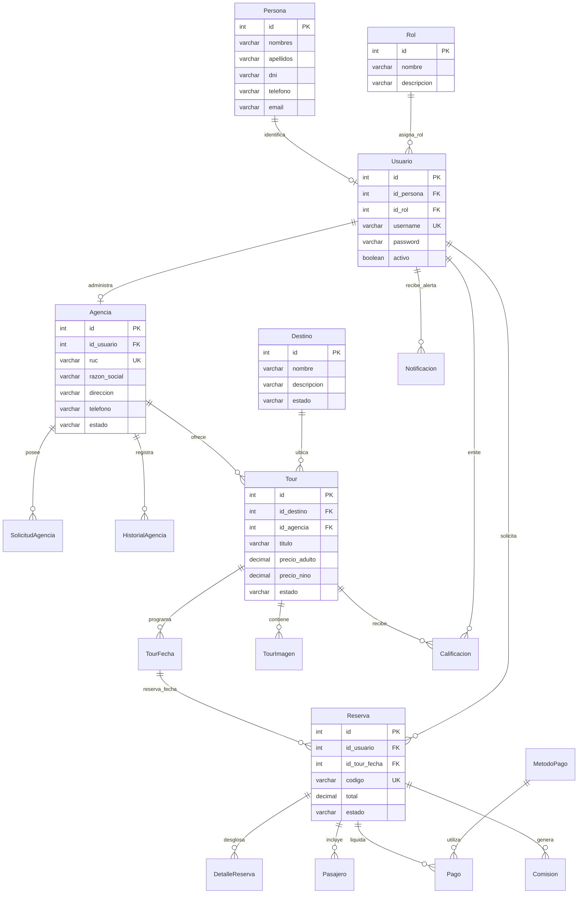

# Modelo Lógico y Físico de Base de Datos — TRAVELINK

Este documento especifica el modelo relacional de base de datos de TRAVELINK, extraído directamente del script DDL de producción [`sql/travelink_schema.sql`](../../../sql/travelink_schema.sql), desglosando el diagrama Entidad-Relación (ER), el modelo lógico y el modelo físico de implementación en MySQL 8.0.

---

## 1. Diagrama Entidad-Relación Global (Mermaid erDiagram)

---

## 2. Modelo Lógico de Datos

El modelo lógico organiza la persistencia en cuatro módulos de negocio principales:

### 2.1 Módulo de Identidad y Acceso (RBAC)
- **`Rol`**: Catálogo maestro de roles del sistema (`ADMIN`, `AGENCIA`, `TURISTA`).
- **`Persona`**: Datos personales y demográficos desacoplados de las credenciales de autenticación (nombres, documento nacional, correo personal).
- **`Usuario`**: Cuenta de seguridad para login (nombre de usuario único, hash BCrypt, estado y rol asignado).

### 2.2 Módulo de Afiliación de Agencias
- **`Agencia`**: Perfil comercial y fiscal de la empresa de turismo (RUC único, razón social, dirección, porcentaje de comisión fijado al 15%).
- **`SolicitudAgencia`**: Registro de peticiones de registro remitidas por agencias pendientes de validación por el administrador.
- **`HistorialAgencia`**: Pista de auditoría del ciclo de vida y cambios de estado de la agencia (`PENDIENTE` -> `APROBADA` / `RECHAZADA`).

### 2.3 Módulo de Catálogo Turístico
- **`Destino`**: Regiones y locaciones turísticas normalizadas (ej. Cusco, Arequipa, Máncora).
- **`Tour`**: Ficha del paquete turístico ofrecido por una agencia, con slug web único, precios diferenciados (adulto, niño, bebé) y políticas de inclusión.
- **`TourFecha`**: Salidas programadas con control estricto de cupo (`cupoTotal`, `cupoDisponible`) y restricción de unicidad por fecha/hora.
- **`TourImagen`**: Galería fotográfica asociada con indicador de portada (`esPrincipal`) y orden de visualización.

### 2.4 Módulo Transaccional: Reservas, Pasajeros y Liquidación
- **`Reserva`**: Encabezado del contrato de viaje, asociado al turista, agencia, fecha y código alfanumérico único.
- **`DetalleReserva`**: Desglose de asientos reservados y subtotales por grupo etario.
- **`Pasajero`**: Registro nominal de cada viajero (documento de identidad, titularidad y edad).
- **`MetodoPago` y `Pago`**: Transacciones financieras, comprobantes y referencias de operación.
- **`Comision`**: Conciliación de comisiones de plataforma (15%) adeudadas por la agencia.
- **`Calificacion`**: Reseñas verificadas vinculadas obligatoriamente a una reserva concluida (1 a 5 estrellas).
- **`Notificacion`**: Despacho de avisos y alertas operativas a los perfiles de usuario.

---

## 3. Modelo Físico de Datos (MySQL 8.0)

### 3.1 Motor de Almacenamiento y Codificación
- **Motor**: `InnoDB` (compatibilidad transaccional ACID, claves foráneas y bloqueo a nivel de fila).
- **Charset / Collation**: `utf8mb4` / `utf8mb4_unicode_ci` (soporte completo de caracteres internacionales, tildes y símbolos).

### 3.2 Catálogo de Índices de Rendimiento

| Tabla | Nombre del Índice | Columnas Indexadas | Propósito de Optimización |
|---|---|---|---|
| `Tour` | `idx_tour_agencia_estado` | `(idAgencia, estado)` | Filtro rápido en portal de agencia para tours activos |
| `Tour` | `idx_tour_destino` | `(idDestino)` | Búsqueda pública por destino en portal principal |
| `TourFecha` | `uq_tour_fecha_hora` | `(idTour, fecha, horaInicio)` | Restricción UNIQUE: previene duplicidad de salidas idénticas |
| `TourFecha` | `idx_tourfecha_fecha` | `(idTour, fecha)` | Búsqueda de disponibilidad en calendario |
| `TourImagen` | `idx_tourimagen_orden` | `(idTour, esPrincipal, orden)` | Carga prioritaria de imagen de portada en catálogo |
| `Reserva` | `idx_reserva_usuario` | `(idUsuario)` | Historial de compras en portal del turista |
| `Reserva` | `idx_reserva_agencia` | `(idAgencia)` | Bandeja de reservas recibidas por la agencia |
| `Reserva` | `idx_reserva_tourfecha` | `(idTourFecha)` | Control de cupos y cruce con salidas |
| `Reserva` | `idx_reserva_estado` | `(estado)` | Filtros de reportes analíticos |
| `Calificacion` | `idx_calificacion_agencia` | `(idAgencia)` | Cálculo de promedio de satisfacción por agencia |
| `Calificacion` | `idx_calificacion_reserva` | `(idReserva)` | Restricción y verificación de compra previa |

### 3.3 Políticas de Integridad Referencial
- **`ON DELETE RESTRICT ON UPDATE CASCADE`**: Aplicada en entidades principales (`Usuario`, `Rol`, `Persona`, `Agencia`, `Destino`, `Tour`) para evitar eliminaciones accidentales en cascada que dejen registros huérfanos en auditoría financiera.
- **`ON DELETE CASCADE ON UPDATE CASCADE`**: Aplicada en detalles subordinados (`DetalleReserva`, `Pasajero`, `TourImagen`, `MetodoPago`) donde la eliminación del registro maestro justifica la eliminación de sus componentes asociados.

---

## 4. Diccionario de Integridad Relacional y Reglas de Dominio

La base de datos relacional de **TRAVELINK** está implementada sobre **MySQL 8.0** con cotejamiento UTF-8 multilingüe (`utf8mb4_unicode_ci`) y motor transaccional `InnoDB`.

---

## 1. Diagrama Entidad - Relación (ERD)

---

## 2. Catálogo y Diccionario de Tablas (18 Tablas)

| # | Tabla | Propósito Operacional | Clave Primaria | Claves Foráneas Principales |
|---|---|---|:---:|---|
| 1 | `Rol` | Catálogo de roles del sistema (TURISTA=1, AGENCIA=2, ADMIN=3) | `id` | Ninguna |
| 2 | `Persona` | Datos de filiación ciudadana (DNI, nombres, apellidos, teléfono, email) | `id` | Ninguna |
| 3 | `Usuario` | Credenciales de acceso, rol asignado, estado activo y bloqueo | `id` | `id_persona`, `id_rol` |
| 4 | `Agencia` | Perfil corporativo de agencia de viajes, RUC (11 dígitos) y estado | `id` | `id_usuario` |
| 5 | `SolicitudAgencia` | Historial de solicitudes de afiliación para revisión administrativa | `id` | `id_agencia`, `id_admin` |
| 6 | `HistorialAgencia` | Bitácora de cambios de estado y observaciones de agencias | `id` | `id_agencia` |
| 7 | `Destino` | Catálogo de regiones y ciudades turísticas (Cusco, Lima, etc.) | `id` | Ninguna |
| 8 | `Tour` | Paquete turístico ofrecido por una agencia en un destino específico | `id` | `id_destino`, `id_agencia` |
| 9 | `TourFecha` | Disponibilidad programada: fecha de salida, cupo máximo y cupos disponibles | `id` | `id_tour` |
| 10 | `TourImagen` | Galería multimedia de fotografías asociadas a cada tour | `id` | `id_tour` |
| 11 | `Reserva` | Transacción de reserva: código único, fecha, total y estado | `id` | `id_usuario`, `id_tour_fecha` |
| 12 | `DetalleReserva` | Desglose económico por tipo de tarifa (adultos, niños, infantes) | `id` | `id_reserva` |
| 13 | `Pasajero` | Manifiesto de viajeros con DNI, nombres y edad vinculados a la reserva | `id` | `id_reserva` |
| 14 | `MetodoPago` | Catálogo de pasarelas y métodos habilitados (Tarjeta, Transferencia, Yape) | `id` | Ninguna |
| 15 | `Pago` | Registro de transacciones monetarias, comprobante y código de operación | `id` | `id_reserva`, `id_metodo_pago` |
| 16 | `Calificacion` | Reseñas, puntuación en estrellas (1-5), comentario y estado de moderación | `id` | `id_usuario`, `id_tour` |
| 17 | `Comision` | Registro contable de comisión de plataforma (15%) y liquidación a agencia | `id` | `id_reserva`, `id_agencia` |
| 18 | `Notificacion` | Alertas de eventos del sistema (confirmaciones, cancelaciones, avisos) | `id` | `id_usuario` |

---

## 3. Integridad Referencial y Estrategia de Índices

- **Restricciones de Unicidad (`UNIQUE KEY`):**
  - `Usuario.username`: Garantiza cuentas unívocas por usuario.
  - `Agencia.ruc`: Restringe un solo registro por identificador tributario SUNAT.
  - `Reserva.codigo`: Código alfanumérico único para identificación de voucher.
- **Acciones en Cascada:**
  - Las relaciones críticas (e.g. `Reserva` con `DetalleReserva` y `Pasajero`) manejan integridad referencial controlada para prevenir registros huérfanos.
- **Optimización de Índices:**
  - Al iniciar la aplicación, `TravelinkApplication` ejecuta un procedimiento de verificación automática creando índices en columnas de búsqueda recurrente (`id_destino`, `id_agencia`, `id_usuario`, `fecha_salida`).
