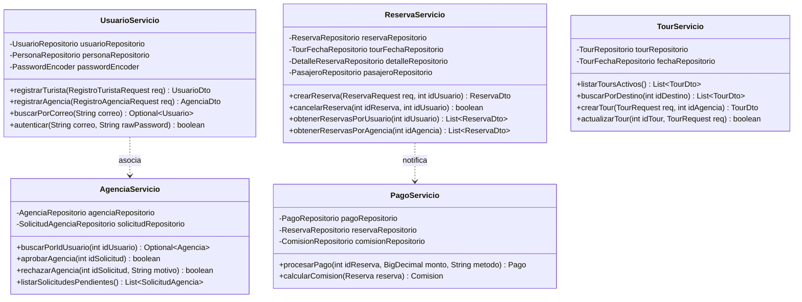

# Diagramas de Clases del Sistema TRAVELINK

Este documento presenta los diagramas de clases orientados a objetos de TRAVELINK modelados mediante sintaxis Mermaid (`classDiagram`), agrupados por capas arquitecturales leídas directamente del código fuente (`Springboot/src/com/travelink/*`).

---

## 1. Grupo 1: Entidades del Modelo de Dominio (`com.travelink.entidades`)

```mermaid
classDiagram
    direction TB

    class Usuario {
        -int idUsuario
        -String correo
        -String contrasenaHash
        -int idRol
        -String estado
        -LocalDateTime fechaRegistro
        +getIdUsuario() int
        +getCorreo() String
        +getContrasenaHash() String
        +getIdRol() int
        +getEstado() String
    }

    class Persona {
        -int idPersona
        -int idUsuario
        -String nombres
        -String apellidos
        -String tipoDocumento
        -String numeroDocumento
        -String telefono
        +getNombreCompleto() String
    }

    class Agencia {
        -int idAgencia
        -int idUsuario
        -String razonSocial
        -String ruc
        -String direccion
        -String telefono
        -String estadoVerificacion
        +getIdAgencia() int
        +getRuc() String
        +getEstadoVerificacion() String
    }

    class Tour {
        -int idTour
        -int idAgencia
        -int idDestino
        -String titulo
        -String descripcion
        -BigDecimal precioBase
        -int duracionDias
        -int cupoMaximo
        -String estado
        +getIdTour() int
        +getTitulo() String
        +getPrecioBase() BigDecimal
    }

    class TourFecha {
        -int idTourFecha
        -int idTour
        -LocalDate fechaSalida
        -LocalDate fechaRetorno
        -int cuposDisponibles
        -BigDecimal precio
        -String estado
        +getIdTourFecha() int
        +getCuposDisponibles() int
        +decrementarCupos(int n) void
    }

    class Reserva {
        -int idReserva
        -int idUsuario
        -int idTourFecha
        -String codigoReserva
        -String estado
        -BigDecimal total
        -LocalDateTime fechaReserva
        +getIdReserva() int
        +getCodigoReserva() String
        +getTotal() BigDecimal
        +getEstado() String
    }

    class DetalleReserva {
        -int idDetalle
        -int idReserva
        -int idTourFecha
        -int cantidadPasajeros
        -BigDecimal precioUnitario
        -BigDecimal subtotal
        +getCantidadPasajeros() int
        +getSubtotal() BigDecimal
    }

    class Pasajero {
        -int idPasajero
        -int idDetalle
        -String nombres
        -String apellidos
        -String tipoDocumento
        -String numeroDocumento
        -int edad
        +getNombreCompleto() String
        +getNumeroDocumento() String
    }

    class Pago {
        -int idPago
        -int idReserva
        -BigDecimal monto
        -int idMetodoPago
        -String estado
        -String referenciaPago
        -LocalDateTime fechaPago
        +getIdPago() int
        +getMonto() BigDecimal
        +getEstado() String
    }

    class Comision {
        -int idComision
        -int idReserva
        -int idAgencia
        -BigDecimal montoReserva
        -BigDecimal porcentaje
        -BigDecimal montoComision
        -String estado
        -LocalDateTime fechaCreacion
        +getMontoComision() BigDecimal
        +getEstado() String
    }

    Usuario "1" --> "1" Persona : tiene
    Usuario "1" --> "0..1" Agencia : gestiona
    Agencia "1" --> "*" Tour : publica
    Tour "1" --> "*" TourFecha : programa
    TourFecha "1" --> "*" Reserva : agenda
    Reserva "1" --> "*" DetalleReserva : contiene
    DetalleReserva "1" --> "*" Pasajero : incluye
    Reserva "1" --> "0..1" Pago : liquida
    Reserva "1" --> "0..1" Comision : genera
```

---

## 2. Grupo 2: Objetos de Transferencia de Datos (`com.travelink.controlador.dto`)

```mermaid
classDiagram
    direction TB

    class LoginRequest {
        -String correo
        -String password
        +getCorreo() String
        +getPassword() String
    }

    class AuthResponse {
        -String status
        -String token
        -UsuarioDto usuario
        +getStatus() String
        +getToken() String
        +getUsuario() UsuarioDto
    }

    class RegistroTuristaRequest {
        -String nombres
        -String apellidos
        -String correo
        -String password
        -String telefono
        -String tipoDocumento
        -String numeroDocumento
    }

    class RegistroAgenciaRequest {
        -String razonSocial
        -String ruc
        -String direccion
        -String telefono
        -String correo
        -String password
    }

    class ReservaRequest {
        -int idTourFecha
        -List~PasajeroRequest~ pasajeros
        -String metodoPago
        +getIdTourFecha() int
        +getPasajeros() List
    }

    class ReservaDto {
        -int idReserva
        -String codigoReserva
        -String tourTitulo
        -LocalDate fechaSalida
        -BigDecimal total
        -String estado
        -List~PasajeroDto~ pasajeros
    }

    class TourRequest {
        -String titulo
        -String descripcion
        -int idDestino
        -BigDecimal precioBase
        -int duracionDias
        -int cupoMaximo
    }

    class TourDto {
        -int idTour
        -String titulo
        -String descripcion
        -String destinoNombre
        -BigDecimal precioBase
        -List~TourFechaDto~ fechas
    }

    class ImportacionResultadoDto {
        -String status
        -String mensaje
        -int totalFilas
        -int filasImportadas
        -int filasError
        -List~FilaError~ errores
        +agregarError(int fila, String motivo) void
        +incrementarImportadas() void
    }

    ReservaRequest "1" --> "*" PasajeroRequest : compone
    ReservaDto "1" --> "*" PasajeroDto : traslada
    TourDto "1" --> "*" TourFechaDto : expone
```

---

## 3. Grupo 3: Capa de Servicios de Negocio (`com.travelink.servicio`)

---

## 4. Grupo 4: Capa de Repositorios JPA (`com.travelink.repositorio`)

```mermaid
classDiagram
    direction TB

    class JpaRepository~T, ID~ {
        <<interface>>
        +save(T entity) T
        +findById(ID id) Optional~T~
        +findAll() List~T~
        +deleteById(ID id) void
    }

    class UsuarioRepositorio {
        <<interface>>
        +findByCorreo(String correo) Optional~Usuario~
        +existsByCorreo(String correo) boolean
    }

    class ReservaRepositorio {
        <<interface>>
        +findByCodigoReserva(String codigo) Optional~Reserva~
        +findByIdUsuario(int idUsuario) List~Reserva~
        +findByIdTourFechaIn(List~Integer~ ids) List~Reserva~
    }

    class TourRepositorio {
        <<interface>>
        +findByEstado(String estado) List~Tour~
        +findByIdDestinoAndEstado(int idDestino, String estado) List~Tour~
        +findByIdAgencia(int idAgencia) List~Tour~
    }

    class TourFechaRepositorio {
        <<interface>>
        +findByIdTourAndEstado(int idTour, String estado) List~TourFecha~
        +findByFechaSalidaAfter(LocalDate fecha) List~TourFecha~
    }

    class PagoRepositorio {
        <<interface>>
        +findByIdReserva(int idReserva) Optional~Pago~
        +findByReferenciaPago(String ref) Optional~Pago~
    }

    class ComisionRepositorio {
        <<interface>>
        +findByIdAgencia(int idAgencia) List~Comision~
        +findByEstado(String estado) List~Comision~
    }

    JpaRepository <|-- UsuarioRepositorio
    JpaRepository <|-- ReservaRepositorio
    JpaRepository <|-- TourRepositorio
    JpaRepository <|-- TourFechaRepositorio
    JpaRepository <|-- PagoRepositorio
    JpaRepository <|-- ComisionRepositorio
```

---

## 5. Grupo 5: Capa de Controladores REST (`com.travelink.controlador`)

```mermaid
classDiagram
    direction TB

    class AuthApiController {
        -UsuarioServicio usuarioServicio
        -AuthenticationManager authManager
        +login(LoginRequest req) ResponseEntity
        +registerTurista(RegistroTuristaRequest req) ResponseEntity
        +me(Authentication auth) ResponseEntity
        +logout(HttpServletRequest req) ResponseEntity
    }

    class PublicApiController {
        -TourServicio tourServicio
        -DestinoServicio destinoServicio
        +listarDestinos() ResponseEntity
        +listarTours(FiltrosRequest f) ResponseEntity
        +obtenerDetalleTour(int id) ResponseEntity
    }

    class AdminApiController {
        -AgenciasAdminHandler agenciasHandler
        -ComisionesAdminHandler comisionesHandler
        -CalidadAdminHandler calidadHandler
        -UsuariosAdminHandler usuariosHandler
        +obtenerDashboard() ResponseEntity
        +aprobarSolicitudAgencia(int id) ResponseEntity
        +listarComisiones() ResponseEntity
    }

    class AgenciaApiController {
        -TourServicio tourServicio
        -ReservaServicio reservaServicio
        +crearTour(TourRequest req) ResponseEntity
        +listarMisTours() ResponseEntity
        +listarReservasRecibidas() ResponseEntity
    }

    class ReportesController {
        -PdfReporteService pdfReporteService
        -ExcelReporteService excelReporteService
        -AgenciaServicio agenciaServicio
        +descargarComprobantePdf(String id, String codigo, HttpServletResponse res) void
        +descargarComisionesPdf(HttpServletResponse res) void
        +descargarReservasAgenciaExcel(String inicio, String fin, HttpServletResponse res) void
        +descargarPagosAgenciaExcel(String inicio, String fin, HttpServletResponse res) void
        +descargarReservasAdminExcel(String inicio, String fin, HttpServletResponse res) void
    }

    AuthApiController ..> UsuarioServicio : invoca
    AgenciaApiController ..> TourServicio : invoca
    PublicApiController ..> TourServicio : invoca
    ReportesController ..> AgenciaServicio : consulta
```

