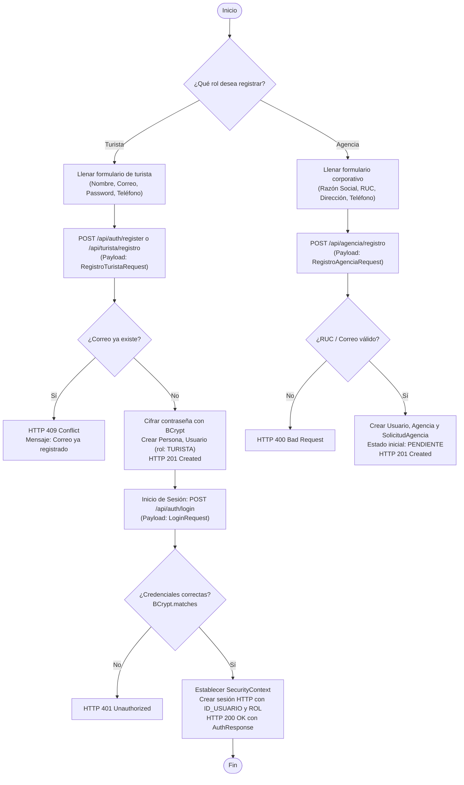
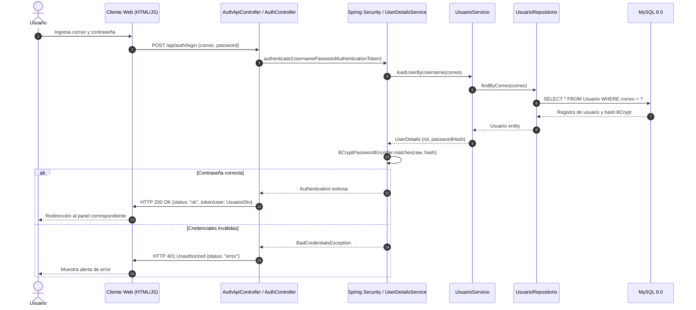
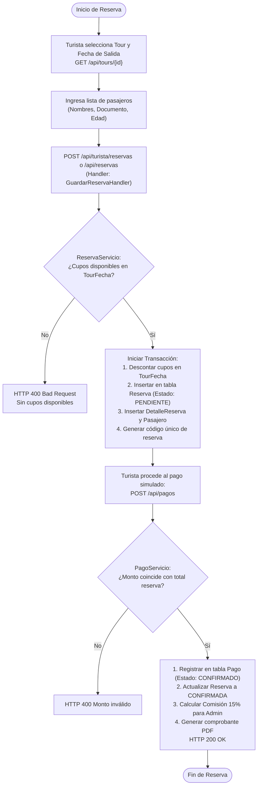
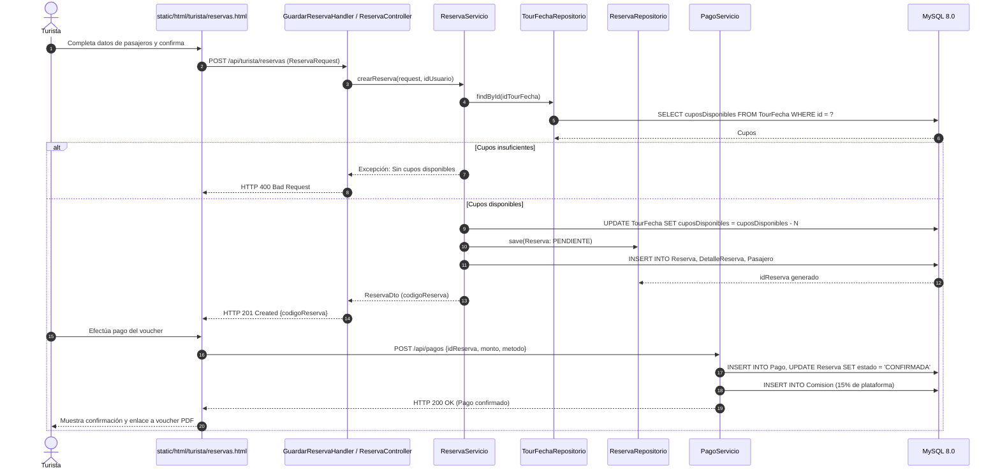
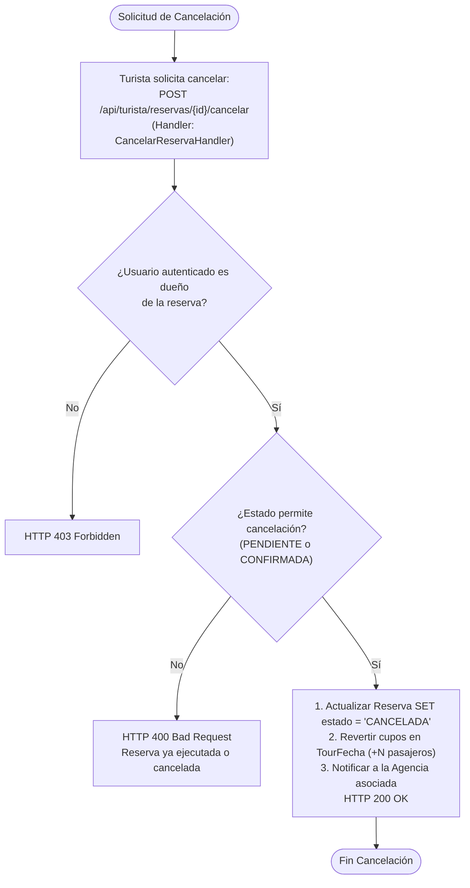
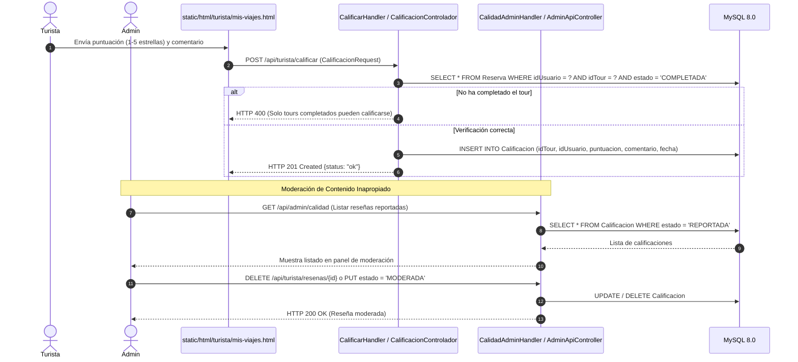
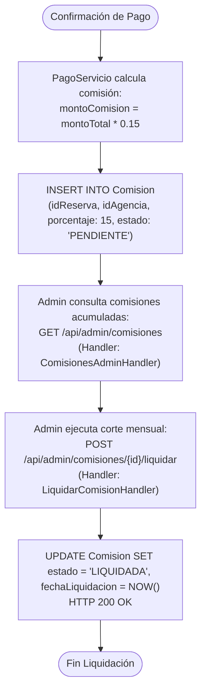

# Diagramas de Procesos de Negocio — TRAVELINK

Este documento especifica los flujos de procesos implementados en el código fuente de TRAVELINK (`Springboot/src/com/travelink/controlador/*` y `servicio/*`), modelados mediante diagramas de flujo (`flowchart`) y diagramas de secuencia (`sequenceDiagram`) en sintaxis Mermaid.

---

## 1. Proceso de Registro y Autenticación (Login / Logout)

### 1.1 Diagrama de Flujo (Flowchart)


### 1.2 Diagrama de Secuencia: Login de Usuario


---

## 2. Proceso de Creación y Confirmación de Reserva

### 2.1 Diagrama de Flujo (Flowchart)


### 2.2 Diagrama de Secuencia: Guardar Reserva y Pago


---

## 3. Proceso de Cancelación de Reserva

### 3.1 Diagrama de Flujo (Flowchart)


---

## 4. Proceso de Calificación y Moderación

### 4.1 Diagrama de Secuencia: Calificación por Turista y Moderación Admin


---

## 5. Proceso de Liquidación de Comisiones

### 5.1 Diagrama de Flujo (Flowchart)


---

## 6. Proceso de Importación de Ficheros (Carga Masiva)

### 6.1 Diagrama de Secuencia: Importación de Ficheros de Catálogo
```mermaid
sequenceDiagram
    autonumber
    actor Agencia
    participant UI as static/html/agencia/paquetes.html
    participant ApiCtrl as AgenciaApiController / PaquetesAgenciaHandler
    participant Dto as ImportacionResultadoDto
    participant POI as Apache POI Parser
    participant DB as MySQL 8.0

    Agencia->>UI: Selecciona archivo Excel (.xlsx) y presiona "Importar"
    UI->>ApiCtrl: POST /api/agencia/tours/importar (MultipartFile file)
    Note over ApiCtrl: [Pendiente de confirmar integración completa de endpoint en controlador;<br/>DTO ImportacionResultadoDto implementado]
    ApiCtrl->>POI: Abrir Workbook(file.getInputStream())
    loop Por cada fila del Excel
        POI->>ApiCtrl: Leer celdas (Título, Destino, Precio, Cupo)
        alt Fila con datos inválidos o vacíos
            ApiCtrl->>Dto: agregarError(numFila, motivo)
        else Fila válida
            ApiCtrl->>DB: INSERT INTO Tour, TourFecha
            ApiCtrl->>Dto: incrementarImportadas()
        end
    end
    ApiCtrl-->>UI: HTTP 200 OK (ImportacionResultadoDto: totalFilas, importadas, errores)
    UI-->>Agencia: Despliega modal con resumen de filas importadas y errores
```

---

## 7. Proceso de Generación y Descarga de Reportes

### 7.1 Diagrama de Secuencia: Emisión de Documentos (PDF / Excel)
```mermaid
sequenceDiagram
    autonumber
    actor Solicitante as Turista / Agencia / Admin
    participant UI as Navegador Web
    participant RepCtrl as ReportesController
    participant SecUtils as SecurityUtils (RBAC)
    participant PdfSvc as PdfReporteService (OpenPDF)
    participant XlsSvc as ExcelReporteService (Apache POI)
    participant DB as MySQL 8.0

    Solicitante->>UI: Clic en "Descargar Comprobante PDF" o "Exportar Excel"
    alt Reporte PDF: GET /api/turista/reservas/{id}/comprobante.pdf
        UI->>RepCtrl: GET /api/turista/reservas/{id}/comprobante.pdf
        RepCtrl->>SecUtils: getAuthenticatedIdUsuario()
        RepCtrl->>DB: Validar propiedad (authUserId == resIdUsuario o isAdmin)
        RepCtrl->>PdfSvc: generarComprobanteReservaPdf(idReserva, outStream)
        PdfSvc->>DB: Consultar reserva, pasajeros y tour
        PdfSvc->>RepCtrl: Escribir bytes OpenPDF
        RepCtrl-->>UI: HTTP 200 OK [Content-Type: application/pdf]<br/>Content-Disposition: attachment; filename="reporte_reserva_turista_YYYYMMDD.pdf"
    else Reporte Excel: GET /api/agencia/reportes/reservas.xlsx
        UI->>RepCtrl: GET /api/agencia/reportes/reservas.xlsx?fechaInicio=...
        RepCtrl->>SecUtils: resolverIdAgencia()
        RepCtrl->>XlsSvc: generarReservasAgenciaExcel(agencyId, outStream)
        XlsSvc->>DB: SELECT * FROM Reserva WHERE idAgencia = ?
        XlsSvc->>RepCtrl: Escribir hojas de cálculo Apache POI
        RepCtrl-->>UI: HTTP 200 OK [Content-Type: application/vnd.openxmlformats-officedocument...]<br/>Content-Disposition: attachment; filename="reporte_reservas_agencia_YYYYMMDD.xlsx"
    end
    UI-->>Solicitante: Inicia descarga del archivo en el navegador
```
