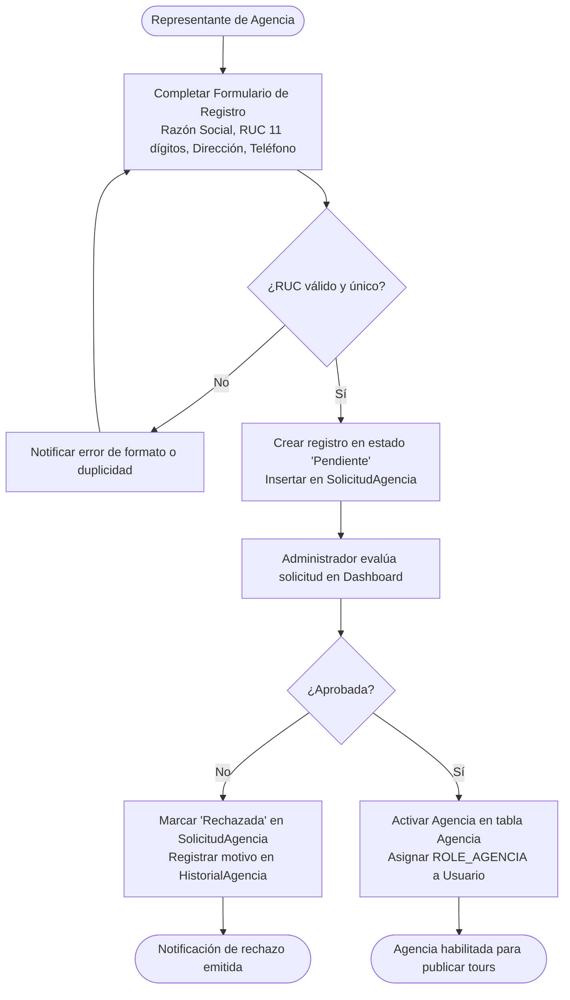
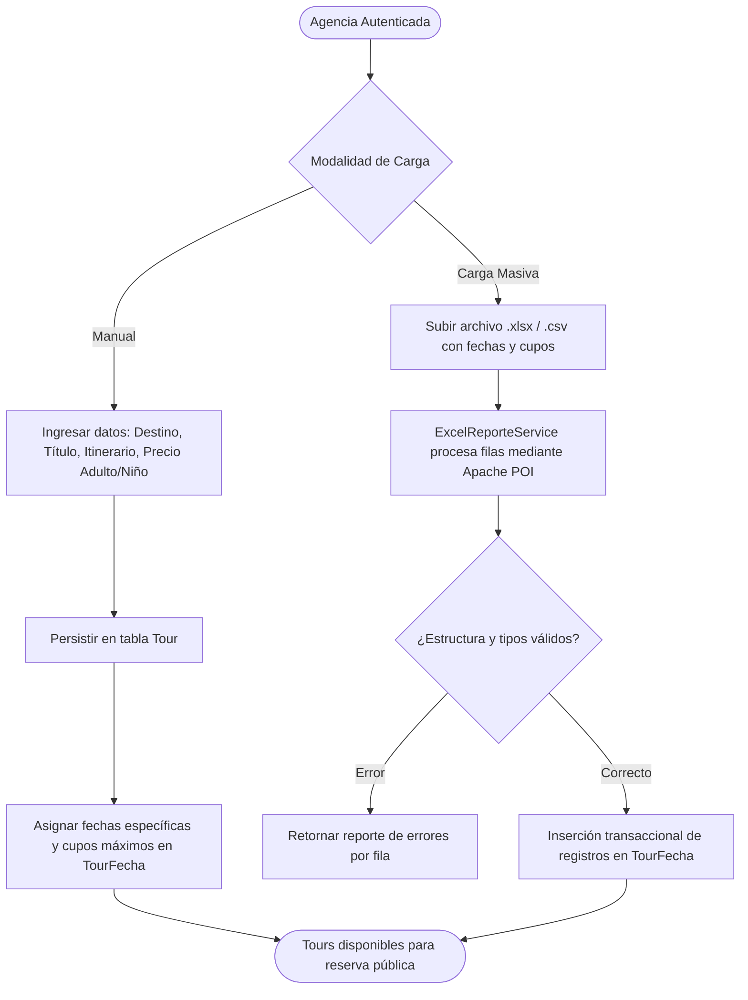
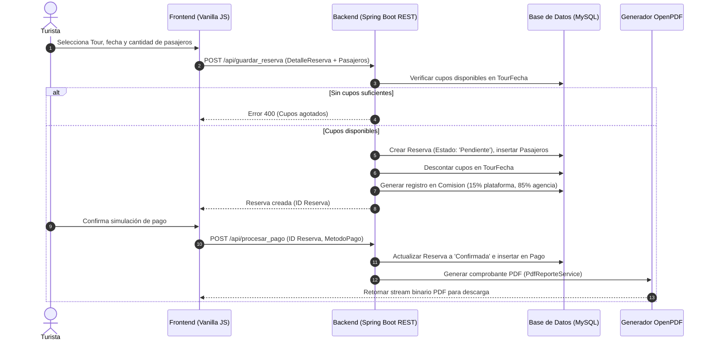

# Especificación de Procesos de Negocio — TRAVELINK 🔄

El sistema **TRAVELINK** opera como una plataforma bilateral de intermediación turística orientada al mercado peruano. Conecta a tres actores clave mediante flujos de negocio estructurados:

1. **Turistas (Rol 1):** Búsqueda de destinos/tours, reserva en línea, registro de pasajeros, pago simulado y emisión de comprobante PDF.
2. **Agencias de Viaje (Rol 2):** Registro formal con RUC (11 dígitos), publicación de tours, programación de fechas y cupos, carga masiva Excel/CSV y consulta de liquidaciones.
3. **Administradores (Rol 3):** Aprobación de agencias, monitoreo de métricas operacionales, cálculo y liquidación de comisiones de plataforma (15%) y moderación de contenido.

---

## 1. Proceso de Registro y Validación Formal de Agencias

---

## 2. Proceso de Creación, Disponibilidad y Carga Masiva de Tours

Las agencias publican tours y gestionan cupos de forma individual o mediante libros Excel/CSV (`TourFecha`):

---

## 3. Proceso Integral de Reserva, Pasajeros y Liquidación

---

## 4. Proceso de Liquidación de Comisiones Administrativas (15%)

De acuerdo con las reglas de negocio de TRAVELINK:
- La plataforma retiene una comisión fija del **15%** sobre el subtotal de cada reserva confirmada.
- El saldo (**85%**) se acredita a la agencia organizadora.
- El administrador ejecuta liquidaciones periódicas mediante el endpoint `/api/comision/liquidar`, generando el corte contable en la tabla `Comision` y emitiendo reportes de pago vía Apache POI Excel.
