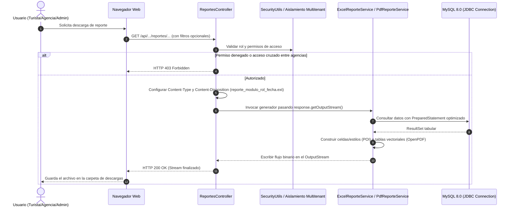

# Modelo de Reportes y Gestión de Ficheros — TRAVELINK

Este documento especifica la arquitectura de generación de documentos PDF (OpenPDF 1.3.39), hojas de cálculo Excel (Apache POI 5.2.5 con streaming `SXSSFWorkbook`), la convención de nomenclatura de ficheros y los flujos de exportación e importación de datos en TRAVELINK.

---

## 1. Convención Estándar de Nombres de Ficheros

Todos los documentos descargables generados por `ReportesController` (`com.travelink.reportes`) aplican una nomenclatura predecible y estandarizada mediante la cabecera HTTP `Content-Disposition`:

```text
reporte_[modulo]_[rol]_[yyyyMMdd].[extension]
```

### Ejemplos Reales:
- `reporte_reserva_turista_20261118.pdf` (Comprobante emitido al turista)
- `reporte_reservas_agencia_20261118.xlsx` (Listado de ventas de la agencia)
- `reporte_pagos_agencia_20261118.xlsx` (Conciliación de pagos de la agencia)
- `reporte_comisiones_admin_20261118.pdf` (Resumen ejecutivo de comisiones para auditoría)
- `reporte_usuarios_admin_20261118.xlsx` (Padrón general de usuarios)

---

## 2. Catálogo Detallado de Reportes

### 2.1 Reportes en Formato PDF (OpenPDF 1.3.39)

| Código | Documento | Endpoint REST | Rol Autorizado | Parámetros | Columnas / Contenido Estructurado |
|---|---|---|---|---|---|
| **PDF-01** | **Comprobante de Reserva (Voucher de Viaje)** | `GET /api/turista/reservas/{id}/comprobante.pdf`<br>`GET /api/reservas/{id}/comprobante.pdf` | Turista dueño, Agencia proveedora, Administrador | `id` (path), `codigo` (opcional query) | • **Cabecera**: Logotipo TRAVELINK, Código de Reserva, Fecha de Emisión.<br>• **Datos del Viaje**: Nombre del Tour, Destino, Agencia operadora, Fecha de Salida, Hora de Partida, Punto de Encuentro.<br>• **Manifiesto de Pasajeros**: N°, Nombre Completo, Tipo de Documento, Nro. Documento, Categoría (Adulto/Niño).<br>• **Desglose Económico**: Cantidad, Precio Unitario, Total Pagado (S/), Estado del Pago.<br>• **Políticas**: Términos de cancelación y contacto de auxilio rápido. |
| **PDF-02** | **Liquidación de Comisiones de Plataforma** | `GET /api/admin/reportes/comisiones.pdf`<br>`GET /api/admin/reportes/comisiones-pdf` | Administrador | Ninguno | • **Resumen Ejecutivo**: Total de ventas brutas, Comisiones acumuladas (15%), Comisiones liquidadas, Saldo pendiente.<br>• **Detalle por Agencia**: ID Agencia, Razón Social, RUC, Total Reservas, Monto Total Facturado, Comisión TRAVELINK (S/), Estado de Liquidación. |

### 2.2 Reportes en Formato Excel (Apache POI 5.2.5 — `SXSSFWorkbook`)

Se utiliza la variante de streaming `SXSSFWorkbook(100)` con ventana de 100 filas en memoria para garantizar que la generación de hojas de cálculo masivas no degrade la memoria heap de la JVM.

| Código | Documento | Endpoint REST | Rol Autorizado | Parámetros de Filtro | Columnas Incluidas en la Hoja de Cálculo |
|---|---|---|---|---|---|
| **XLS-01** | **Reservas de Agencia** | `GET /api/agencia/reportes/reservas.xlsx` | Agencia | `fechaInicio` (YYYY-MM-DD), `fechaFin`, `estado` | 1. ID Reserva<br>2. Código<br>3. Fecha Registro<br>4. Tour<br>5. Fecha Salida<br>6. Hora Salida<br>7. Turista / Titular<br>8. Adultos<br>9. Niños<br>10. Bebés<br>11. Total Pasajeros<br>12. Total (S/)<br>13. Estado Reserva<br>14. Estado Pago |
| **XLS-02** | **Pagos de Agencia** | `GET /api/agencia/reportes/pagos.xlsx` | Agencia | `fechaInicio`, `fechaFin`, `estado` | 1. ID Pago<br>2. Código Reserva<br>3. Fecha Pago<br>4. Tour<br>5. Turista / Titular<br>6. Método Pago<br>7. Nro. Operación<br>8. Monto Total (S/)<br>9. Comisión TRAVELINK 15% (S/)<br>10. Monto Neto Agencia (S/)<br>11. Estado Pago |
| **XLS-03** | **Reservas Globales Admin** | `GET /api/admin/reportes/reservas.xlsx` | Administrador | `fechaInicio`, `fechaFin`, `estado` | 1. ID Reserva<br>2. Código<br>3. Fecha Registro<br>4. Agencia Proveedora<br>5. Tour Turístico<br>6. Fecha Salida<br>7. Titular Reserva<br>8. Pasajeros<br>9. Total Facturado (S/)<br>10. Estado Reserva<br>11. Estado Pago |
| **XLS-04** | **Comisiones Globales Admin** | `GET /api/admin/reportes/comisiones.xlsx` | Administrador | Ninguno | 1. ID Comisión<br>2. ID Agencia<br>3. Razón Social<br>4. RUC<br>5. Periodo<br>6. Ventas Brutas (S/)<br>7. % Comisión (15%)<br>8. Comisión Plataforma (S/)<br>9. Monto Neto Agencia (S/)<br>10. Estado Liquidación<br>11. Fecha Cálculo<br>12. Fecha Liquidación |
| **XLS-05** | **Padrón de Usuarios** | `GET /api/admin/reportes/usuarios.xlsx` | Administrador | Ninguno | 1. ID Usuario<br>2. Nombre Completo<br>3. Correo Electrónico<br>4. Teléfono<br>5. Tipo Documento<br>6. Nro. Documento<br>7. Rol Asignado<br>8. Estado Cuenta<br>9. Fecha Registro |
| **XLS-06** | **Directorio de Agencias** | `GET /api/admin/reportes/agencias.xlsx` | Administrador | Ninguno | 1. ID Agencia<br>2. ID Usuario<br>3. Razón Social<br>4. RUC<br>5. Teléfono Corporativo<br>6. Email Corporativo<br>7. Dirección Fiscal<br>8. % Comisión Pactado<br>9. Calificación Promedio<br>10. Estado Verificación<br>11. Fecha Registro |

---

## 3. Flujo de Exportación de Documentos



---

## 4. Flujo de Importación y Carga Masiva de Ficheros

TRAVELINK incorpora en su diseño el modelo de importación masiva de tours y salidas para facilitar la incorporación ágil del catálogo de las agencias de viaje:

```mermaid
sequenceDiagram
    autonumber
    actor Agencia
    participant UI as static/html/agencia/paquetes.html
    participant Ctrl as AgenciaApiController (Import Handler)
    participant Parser as Apache POI Workbook Parser
    participant DTO as ImportacionResultadoDto
    participant Svc as TourServicio
    participant DB as MySQL 8.0

    Agencia->>UI: Carga archivo .xlsx con plantilla de tours
    UI->>Ctrl: POST /api/agencia/tours/importar [MultipartFile file]
    Note over Ctrl: [DTO ImportacionResultadoDto implementado en com.travelink.controlador.dto;<br/>integración del endpoint en controlador pendiente de confirmar]
    Ctrl->>Parser: Leer filas de la hoja de cálculo
    Parser->>DTO: Inicializar totalFilas = N
    loop Por cada fila del archivo Excel
        alt Celda obligatoria vacía o formato inválido (precio negativo, cupo 0)
            Parser->>DTO: agregarError(numFila, "Dato inválido en columna X")
        else Fila con datos consistentes
            Parser->>Svc: Mapear a TourRequest y guardar
            Svc->>DB: INSERT INTO Tour, TourFecha
            Parser->>DTO: incrementarImportadas()
        end
    end
    Ctrl-->>UI: HTTP 200 OK (ImportacionResultadoDto: total, importadas, fallidas, errores[])
    UI-->>Agencia: Muestra resumen de filas exitosas y tabla de errores detallados
```


---

## 5. Especificación y Requerimientos de Exportación de Reportes

## 1. Visión General del Módulo

El subsistema de reportes de TRAVELINK (`com.travelink.reportes`) proporciona la generación dinámica de documentos formales en formato PDF y hojas de cálculo tabulares en formato Microsoft Excel (OOXML `.xlsx`). Su objetivo es respaldar las operaciones comerciales de los turistas, la conciliación financiera de las agencias de viajes y la auditoría global por parte de los administradores.

### Tecnologías Empleadas
- **OpenPDF 1.3.39**: Generación de documentos PDF vectoriales (comprobantes de reserva y liquidaciones).
- **Apache POI 5.2.5 (`poi-ooxml`)**: Creación de libros Excel con estilos tipográficos, cabeceras coloreadas y autoajuste de columnas.
- **Controlador Orquestador**: `ReportesController` expone endpoints REST protegidos por Spring Security.

---

## 2. Convención de Nomenclatura

Todos los documentos descargados siguen una convención estandarizada en la cabecera HTTP `Content-Disposition`:

```text
reporte_[modulo]_[rol]_[yyyyMMdd].[extension]
```

Ejemplos:
- `reporte_reserva_turista_20261118.pdf`
- `reporte_reservas_agencia_20261118.xlsx`
- `reporte_comisiones_admin_20261118.pdf`

---

## 3. Catálogo de Reportes

### 3.1 Documentos en Formato PDF (OpenPDF)

| Código | Documento | Endpoint REST | Rol Autorizado | Parámetros | Descripción |
|---|---|---|---|---|---|
| **REP-PDF-01** | Comprobante de Reserva | `GET /api/turista/reservas/{id}/comprobante.pdf` | Turista (propietario), Agencia, Admin | `id` (path) o `codigo` (query) | Emite el voucher de viaje con desglose de pasajeros, código QR/referencia, datos del tour, fecha y monto pagado. |
| **REP-PDF-02** | Liquidación de Comisiones | `GET /api/admin/reportes/comisiones.pdf` | Administrador | Ninguno | Resumen consolidado del porcentaje de comisión recaudado por la plataforma por cada agencia. |

### 3.2 Hojas de Cálculo en Formato Excel (Apache POI)

| Código | Documento | Endpoint REST | Rol Autorizado | Parámetros de Filtrado | Columnas Incluidas |
|---|---|---|---|---|---|
| **REP-XLS-01** | Reservas de Agencia | `GET /api/agencia/reportes/reservas.xlsx` | Agencia | `fechaInicio`, `fechaFin`, `estado` | ID, Código Reserva, Tour, Fecha Salida, Turista, Contacto, N° Pasajeros, Monto Total, Estado, Fecha Reserva |
| **REP-XLS-02** | Pagos de Agencia | `GET /api/agencia/reportes/pagos.xlsx` | Agencia | `fechaInicio`, `fechaFin`, `estado` | ID Pago, Código Reserva, Método, Monto, Referencia Transacción, Fecha Pago, Estado |
| **REP-XLS-03** | Reservas Globales | `GET /api/admin/reportes/reservas.xlsx` | Administrador | `fechaInicio`, `fechaFin`, `estado` | ID, Código, Agencia, Turista, Tour, Fecha, Monto, Estado |
| **REP-XLS-04** | Comisiones Globales | `GET /api/admin/reportes/comisiones.xlsx` | Administrador | Ninguno | ID Comisión, Agencia, Monto Reserva, % Comisión, Monto Comisión, Estado Liquidación, Fecha |
| **REP-XLS-05** | Padrón de Usuarios | `GET /api/admin/reportes/usuarios.xlsx` | Administrador | Ninguno | ID Usuario, Nombre Completo, Email, Teléfono, Rol, Estado, Fecha Registro |
| **REP-XLS-06** | Directorio de Agencias | `GET /api/admin/reportes/agencias.xlsx` | Administrador | Ninguno | ID Agencia, Razón Social, RUC/NIT, Correo Contacto, Teléfono, Estado Verificación, Fecha Afiliación |

---

## 4. Control de Acceso y Seguridad de Datos

1. **Aislamiento Multitenant por Agencia**: Al invocar endpoints bajo `/api/agencia/reportes/*`, la identidad del usuario autenticado se extrae del `SecurityContextHolder`. Se resuelve el `idAgencia` asociado a través de `AgenciaServicio.buscarPorIdUsuario()` o la sesión activa. Una agencia nunca puede consultar transacciones de agencias competidoras.
2. **Propiedad de Comprobantes**: Al descargar un comprobante PDF, se verifica mediante consulta directa que `authUserId == resIdUsuario` o que la agencia corresponda a `resIdAgencia`. Si un usuario intenta forzar la descarga del voucher de otro cliente, se responde con código HTTP `403 Forbidden`.
3. **Prevención de Caché Sensible**: Todas las respuestas incorporan la cabecera `Cache-Control: no-cache, no-store, must-revalidate` para evitar que información financiera quede almacenada en proxies intermedios o cachés de navegador.
