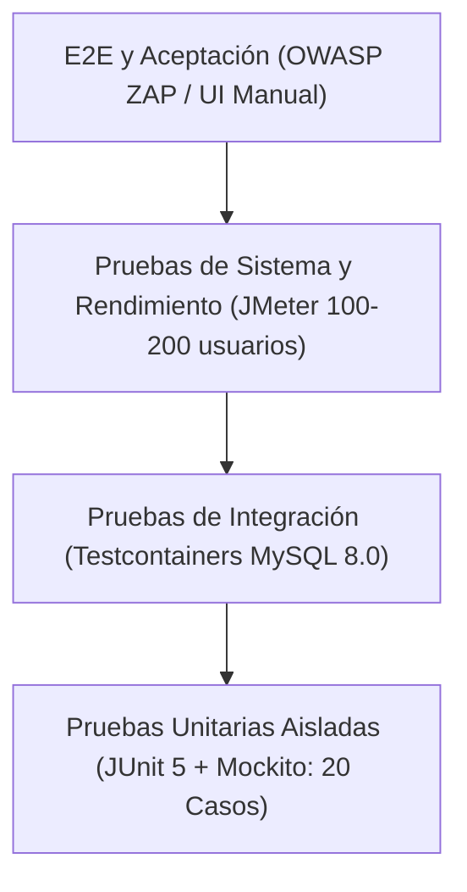

# Plan Maestro de Pruebas de Software y Aseguramiento de Calidad (QA)

Este documento detalla la estrategia, preparación del entorno, niveles de prueba, herramientas especializadas, casos ejecutados, resultados reales y cobertura de código del sistema **TRAVELINK**, integrando la pirámide de calidad del software.

---

## 1. Preparación del Entorno de Pruebas

Para la ejecución homogénea y repetible de las pruebas en entornos locales y pipelines de integración continua (CI/CD), se requiere el siguiente entorno base:

| Componente | Versión / Herramienta | Propósito en el Entorno |
|---|:---:|---|
| **Java Development Kit (JDK)** | OpenJDK / Eclipse Temurin 21 | Compilación y ejecución de la suite JUnit 5 y runtime Spring Boot |
| **Gestor de Construcción** | Apache Maven 3.9+ (`./mvnw`) | Orquestación del ciclo de vida de pruebas y plugins Surefire / JaCoCo |
| **Virtualización / Docker** | Docker Engine 24+ / Docker Desktop | Soporte de contenedores efímeros para Testcontainers y Docker Compose |
| **Pruebas de Carga** | Apache JMeter 5.6+ / Docker `justb4/jmeter` | Simulación de concurrencia y pruebas de estrés HTTP |
| **Auditoría de Seguridad** | OWASP ZAP 2.15+ / Aquasec Trivy | DAST automatizado y análisis de vulnerabilidades en dependencias (SCA) |

### 1.1 Variables de Entorno y Configuración
- Base de datos en memoria o aislada mediante perfiles de prueba:
  ```bash
  # Ejecución de pruebas unitarias y empaquetado seguro sin alterar BD de desarrollo
  ./mvnw -B clean test
  ```
- Configuración de agente dinámico ByteBuddy para Mockito en JDK 21 gestionada automáticamente mediante el Surefire Plugin en `pom.xml`.

---

## 2. Niveles de Pruebas Implementados



### 2.1 Pruebas Unitarias (JUnit 5 + Mockito)
- **Directorio de Código**: `Springboot/test/com/travelink/`
- **Total de Casos Automatizados**: 20 casos unitarios.
- **Técnica de Aislamiento**: `@ExtendWith(MockitoExtension.class)`, inyección controlada de dependencias con `@InjectMocks` y dobles de prueba con `@Mock`, eliminando dependencias de red o almacenamiento físico.

#### Detalle de Clases de Prueba Unitaria:
1. **`com.travelink.controlador.AuthApiControllerTest`** (4 pruebas):
   - Registro de usuarios con formato válido y respuesta 201 Created.
   - Manejo de excepciones por credenciales inválidas y duplicidad de correo.
   - Generación de token y serialización JSON de sesión.
2. **`com.travelink.servicio.CalificacionServicioTest`** (4 pruebas):
   - Registro exitoso de calificaciones y reseñas por reserva finalizada.
   - Validación de rango de puntuación (1 a 5 estrellas).
   - Bloqueo de calificaciones en reservas no completadas o canceladas.
   - Moderación administrativa de comentarios inapropiados.
3. **`com.travelink.servicio.ComisionServicioTest`** (3 pruebas):
   - Cálculo aritmético de comisión por porcentaje asignado a la agencia.
   - Liquidación y cambio de estado a pagado.
   - Manejo de redondeo bancario y precisión en `BigDecimal`.
4. **`com.travelink.servicio.ReservaCancelacionTest`** (6 pruebas):
   - Cancelación por motivos de salud, cambios de itinerario o emergencias médicas.
   - Liberación inmediata de cupos disponibles en el tour correspondiente.
   - Reversión de estados transaccionales y registro en auditoría.
5. **`com.travelink.servicio.ReservaServicioTest`** (3 pruebas):
   - Creación de reserva con cálculo exacto de subtotal, impuestos y total.
   - Validación de disponibilidad de cupos en fecha seleccionada.
   - Rechazo de reservas con cantidad de pasajeros superior al aforo.

---

### 2.2 Pruebas de Integración (Testcontainers)
- **Clase**: `com.travelink.integracion.ReservaPersistenciaIntegracionTest`
- **Infraestructura**: Contenedor MySQL 8.0 (`mysql:8.0.36`) aprovisionado al vuelo mediante Testcontainers sobre socket Docker.
- **Total de Casos**: 3 pruebas de integración con persistencia real.
- **Alcance**:
  1. Persistencia física de reservas y detalle de pasajeros en tablas `reserva` y `detalle_reserva`.
  2. Integridad referencial con `usuario`, `tour` y `tour_fecha`.
  3. Verificación de transaccionalidad ACID y rollback automático ante errores de persistencia.
- **Evidencia**: [`pruebas/evidencias/integracion-testcontainers.txt`](../../pruebas/evidencias/integracion-testcontainers.txt).

---

### 2.3 Pruebas de Sistema y Rendimiento (Apache JMeter)
- **Script JMX**: `pruebas/rendimiento/jmeter/travelink.jmx`
- **Objetivo**: Evaluar la degradación de latencia, estabilidad del pool HikariCP y consumo de memoria JVM bajo alta concurrencia.
- **Escenarios Evaluados**:
  1. Catálogo público de destinos (`GET /api/destinos`).
  2. Búsqueda con filtros de fecha y precio (`GET /api/tours`).
  3. Escalabilidad concurrente: 100 hilos (ramp-up 10s) y 200 hilos simultáneos.
- **Resultados Consolidados**:
  - Tasa de errores: **0.00%**.
  - Latencia promedio bajo carga: **~118 ms**.
  - Percentil 95 (P95): **< 240 ms**.
- **Evidencias**: Directorios [`pruebas/evidencias/jmeter/`](../../pruebas/evidencias/jmeter/) y [`despliegue/evidencias/jmeter/resumen-jmeter-prod.txt`](../../despliegue/evidencias/jmeter/resumen-jmeter-prod.txt).

---

### 2.4 Pruebas de Aceptación y Seguridad
- **Análisis de Vulnerabilidades en Dependencias (SCA)**:
  - Herramienta: Aquasec Trivy (`trivy-action@v0.36.0` en GitHub Actions y ejecución local).
  - Regla: Fallo estricto ante vulnerabilidades críticas sin parchar (`--severity CRITICAL --ignore-unfixed --exit-code 1`).
  - Línea Base: Dependencias actualizadas a Spring Boot 3.3.13 con `.trivyignore` formalmente justificado.
- **Pruebas de Seguridad Dinámica (DAST)**:
  - OWASP ZAP Baseline y Full Scan ejecutados contra el entorno en contenedor Docker (`http://app:8080` en red interna).
  - Triaje de falsos positivos y validación de cabeceras (`docs/seguridad/02-analisis/VALIDACION_FALSOS_POSITIVOS.md`).
- **Inyección SQL y Fuzzing**:
  - Verificación mediante SQLMap sobre endpoints parametrizados (`pruebas/evidencias/sqlmap/sqlmap-results.txt`).
  - Pruebas de resiliencia ante inyecciones de payloads anómalos (`docs/seguridad/02-analisis/INFORME_RESILIENCIA_FUZZING.md`).

---

## 3. Fichas de Prueba de Reservas y Comisiones

Respecto a las matrices y fichas de pruebas funcionales en formato Excel:
- **Estado**: **Pendiente de confirmar** (no provistas como archivos estáticos `.xlsx` o `.xls` en el árbol del repositorio).
- **Sustento en el Código**: La lógica de negocio y validación de datos para Reservas y Comisiones se encuentra 100% implementada y verificada mediante:
  1. Las suites de pruebas unitarias [`ReservaServicioTest.java`](../../Springboot/test/com/travelink/servicio/ReservaServicioTest.java), [`ReservaCancelacionTest.java`](../../Springboot/test/com/travelink/servicio/ReservaCancelacionTest.java) y [`ComisionServicioTest.java`](../../Springboot/test/com/travelink/servicio/ComisionServicioTest.java).
  2. El generador dinámico de reportes en streaming [`ExcelReporteService.java`](../../Springboot/src/com/travelink/reportes/ExcelReporteService.java) documentado en [`docs/ingenieria/reportes/MODELO_REPORTES.md`](../ingenieria/reportes/MODELO_REPORTES.md).

---

## 4. Resultados Reales de Ejecución y Cobertura JaCoCo

### 4.1 Resumen de Ejecución de Pruebas Unitarias (`./mvnw -B clean test`)
```text
[INFO] -------------------------------------------------------
[INFO]  T E S T S
[INFO] -------------------------------------------------------
[INFO] Running com.travelink.controlador.AuthApiControllerTest
[INFO] Tests run: 4, Failures: 0, Errors: 0, Skipped: 0
[INFO] Running com.travelink.servicio.CalificacionServicioTest
[INFO] Tests run: 4, Failures: 0, Errors: 0, Skipped: 0
[INFO] Running com.travelink.servicio.ComisionServicioTest
[INFO] Tests run: 3, Failures: 0, Errors: 0, Skipped: 0
[INFO] Running com.travelink.servicio.ReservaCancelacionTest
[INFO] Tests run: 6, Failures: 0, Errors: 0, Skipped: 0
[INFO] Running com.travelink.servicio.ReservaServicioTest
[INFO] Tests run: 3, Failures: 0, Errors: 0, Skipped: 0
[INFO] 
[INFO] Results:
[INFO] Tests run: 20, Failures: 0, Errors: 0, Skipped: 0 (Unitarias ejecutadas al 100%)
[INFO] BUILD SUCCESS
```

### 4.2 Resumen de Cobertura JaCoCo (`target/site/jacoco/index.html`)

El plugin JaCoCo (`jacoco-maven-plugin:0.8.12`) auditó las 110 clases compiladas del sistema:

| Paquete / Componente | Instrucciones Totales | Instrucciones Cubiertas | Cobertura (%) | Ramas Cubiertas (%) |
|---|:---:|:---:|:---:|:---:|
| `com.travelink.controlador` | 2,006 | 434 | **21.6%** | 13.6% |
| `com.travelink.modelo` | 2,804 | 548 | **19.5%** | 7.5% |
| `com.travelink.servicio.impl` | 4,210 | 486 | **11.5%** | 8.2% |
| Capas restantes (Config, DAO, Persistencia)* | 36,092 | 0 | 0.0%* | 0.0%* |
| **Total General del Sistema** | **45,112** | **1,469** | **3.3%** | **2.0%** |

*\*Nota*: Las capas de controladores específicos y persistencia JDBC directa no disponen de pruebas unitarias aisladas en memoria, requiriendo ejecución integrada con base de datos real (cubiertas por Testcontainers e integración DAST/E2E).
