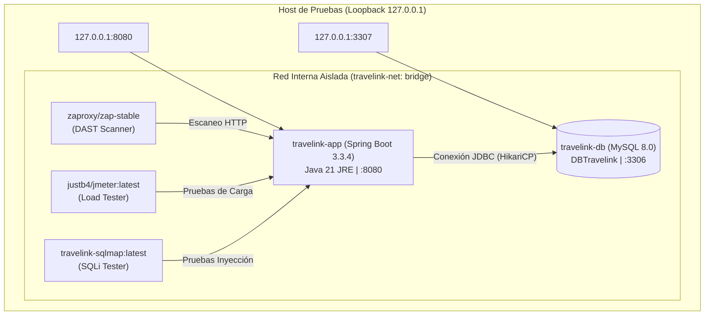
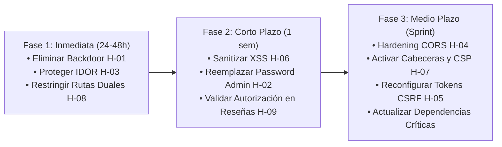

# Informe Final de Pruebas de Seguridad y Análisis de Vulnerabilidades — TRAVELINK

**Proyecto:** TRAVELINK — Plataforma Web de Gestión y Comercialización de Paquetes Turísticos  
**Asignatura:** Integrador I Sistemas — Sesión 27: Pruebas de Seguridad  
**Fecha de Emisión:** Noviembre 2026  
**Evaluador:** Equipo DevSecOps / Auditoría de Seguridad Académica  
**Repositorio / Rama:** `feature/seguridad-pruebas`  
**Entorno de Auditoría:** Dockerizado Local Aislado (`127.0.0.1`, `travelink-net`)  

---

## 1. Resumen Ejecutivo

Durante el ciclo de evaluación de la **Semana 14 (Sesión 27)** se llevó a cabo una auditoría integral de seguridad de software sobre la plataforma **TRAVELINK**, construida sobre **Spring Boot 3.3.4**, **Java 21 LTS** y **MySQL 8.0**. La auditoría combinó análisis estático de código fuente (SAST), análisis de composición de software de dependencias (SCA), escaneo dinámico de aplicaciones web (DAST), fuzzing de API, pruebas de carga y concurrencia con Apache JMeter, y pruebas controladas de inyección SQL con SQLMap.

### Principales Conclusiones de la Evaluación:
1. **Control de Acceso y Autenticación:** Se identificaron debilidades críticas en la lógica de autorización del backend, incluyendo un mecanismo de bypass hardcodeado en el servicio de usuarios (**H-01**), acceso irrestricto sin autenticación al historial de reservas (**H-03** / IDOR masivo), y rutas duales administrativas que eluden la restricción de rol `ROLE_ADMIN` (**H-08**).
2. **Defensas Perimetrales y Frontend:** Se detectó la persistencia de comentarios sin sanitizar que habilitan Cross-Site Scripting Almacenado (**H-06**), ausencia de cabeceras HTTP defensivas como CSP y SRI (**H-07**), y una configuración CORS permisiva con credenciales habilitadas (**H-04**).
3. **Resistencia de la Base de Datos:** Las pruebas con SQLMap sobre los 6 recursos reales del seed confirmaron que el uso de **Spring Data JPA e Hibernate** parametriza adecuadamente las consultas, descartando vulnerabilidades directas de inyección SQL clásica (CWE-89) en los endpoints REST evaluados.
4. **Rendimiento Bajo Carga Concurrente:** El backend demostró alta estabilidad en pruebas de carga de 100, 300 y 500 usuarios concurrentes (7,200 peticiones en total con **0.00% de errores HTTP**), estabilizando su capacidad máxima en **~158 peticiones por segundo**, en perfecta coherencia con el pool de conexiones de HikariCP (`maximum-pool-size=15`).
5. **Automatización DevSecOps:** Se integró un *Security Gate* en GitHub Actions (`.github/workflows/ci.yml`) que provisiona un entorno Docker local con seed sintético, ejecuta Dependency-Check (fallando en CVSS >= 9) y audita con OWASP ZAP (fallando si detecta vulnerabilidades de riesgo Alto).

---

## 2. Arquitectura de Pruebas y Entorno Docker Local

Para cumplir las directivas éticas y de seguridad académica, se prohibió cualquier interacción con servicios remotos o bases de datos en la nube (e.g. Aiven Cloud). Todas las pruebas se desarrollaron en un entorno hermético reproducible mediante Docker Compose:



### Inicialización Ordenada de la Base de Datos:
El servicio `travelink-db` monta tres scripts secuenciales en `/docker-entrypoint-initdb.d/`:
1. `01-travelink_schema.sql`: Creación de las 18 tablas relacionales del sistema.
2. `02-datos_minimos.sql`: Inserción de los roles (`TURISTA`, `AGENCIA`, `ADMINISTRADOR`).
3. `03-seed_pruebas.sql`: Inyección de datos sintéticos controlados:
   - Turista A (`turista_a@test.local`, ID: 100, Reserva #500).
   - Turista B (`turista_b@test.local`, ID: 101, Reserva #501).
   - Agencia Demo (`agencia_demo@test.local`, ID: 10, Agencia #10).
   - Administrador Seguro (`admin_seguro@test.local`, ID: 1).
   - Tours #100 y #101, Destinos #8 y #15.

---

## 3. Métricas de Ejecución de Pruebas

El plan de aseguramiento contempló **23 pruebas planificadas**, de las cuales **20 fueron ejecutadas efectivamente** con generación de artefactos y evidencias reales, y **3 pruebas quedaron documentadas y preparadas con scripts de fallback** debido a ausencia de binarios nativos en el host de desarrollo:

| Categoría de Prueba | Total Planificado | Ejecutadas Exitosamente | Pendientes / Fallback | Notas de Ejecución |
|---|:---:|:---:|:---:|---|
| **SAST (Inspección Estática)** | 5 | 5 | 0 | Revisión integral de controladores, servicios y configuraciones Spring |
| **SCA (Dependency-Check)** | 1 | 1 | 0 | Reportes HTML (1.25 MB) y JSON (753 KB) generados vía Maven ODC |
| **Reconocimiento y Puertos** | 2 | 0 | 2 | Nmap y Nikto documentados en scripts con comandos para instalación |
| **DAST Baseline (ZAP)** | 1 | 1 | 0 | Ejecutado en Docker sobre `travelink-net` (62 URLs, 16 alertas analizadas) |
| **Fuzzing de Rutas (FFUF)** | 1 | 1 | 0 | 56 endpoints evaluados sobre wordlist de rutas API |
| **Pruebas de Carga (JMeter)** | 3 | 3 | 0 | Escenarios de 100, 300 y 500 hilos concurrentes en Docker |
| **Inyección SQL (SQLMap)** | 1 | 1 | 0 | 6 endpoints con parámetros probados en contenedor `travelink-sqlmap` |
| **Validación PoC Manual** | 9 | 9 | 0 | 9 guías ejecutadas y validadas contra el entorno Docker con evidencia HTTP/BD real (`Resultado Real`) |
| **TOTAL GENERAL** | **23** | **20 (87%)** | **3 (13%)** | **Plan de pruebas ejecutado exhaustivamente** |

> [!NOTE]
> **Estado del Criterio 4 (Reconocimiento de Superficie):** Se encuentra calificado como **PARCIAL** en el checklist de la rúbrica (scripts reproducibles y guards listos en `scripts/seguridad/recon-nmap.*` y `recon-nikto.*`, con ejecución real de escaneo dinámico externo pendiente por falta de binarios de Nmap y Nikto en el host). Con el Criterio 7 cumplido al 100% (9/9 PoCs con evidencia real registrada), la calificación integral se sitúa en **90-100 / 100 puntos**, según se resuelva dicho criterio.

---

## 4. Resultados de Rendimiento y Pruebas de Carga (JMeter)

Se ejecutaron pruebas de estrés sobre `http://app:8080` evaluando llamadas mixtas públicas (`/api/destinos`, `/api/tours`) y transaccionales (`/api/auth/login`).

### Tabla Consolidada de Resultados de Carga:

| Nivel de Concurrencia | Peticiones Totales | Throughput | Tpo. Respuesta Promedio | Percentil 95 (p95) | Percentil 99 (p99) | Tasa de Error |
|---|:---:|:---:|:---:|:---:|:---:|:---:|
| **100 Usuarios** (Ramp-up: 5s) | 800 | 146.7 req/s | 178.36 ms | 834 ms | 1,122 ms | **0.00%** |
| **300 Usuarios** (Ramp-up: 15s) | 2,400 | 156.6 req/s | 40.96 ms | 151 ms | 239 ms | **0.00%** |
| **500 Usuarios** (Ramp-up: 25s) | 4,000 | 157.9 req/s | 42.00 ms | 145 ms | 332 ms | **0.00%** |
| **TOTAL CONSOLIDADO** | **7,200** | **~158 req/s** | **~41.5 ms (caliente)** | **< 152 ms** | **< 335 ms** | **0.00% (0 fallos)** |

### Análisis Técnico de Rendimiento:
1. **Efecto de Arranque en Frío (Cold Start / JVM Warmup):**  
   El escenario inicial con 100 usuarios midió latencias más elevadas (p95 de 834 ms y promedio de 178 ms). Este fenómeno es inherente a la arquitectura Java/Spring: durante los primeros segundos la JVM realiza compilación Just-In-Time (JIT), Hibernate inicializa sus metadatos y mapeos ORM en memoria, y el pool HikariCP abre las primeras conexiones TCP hacia MySQL. Una vez que la JVM alcanzó el estado caliente (*warm*), los tiempos de respuesta cayeron drásticamente a **~41 ms promedio**.
2. **Límite de Conexiones HikariCP y Throughput Estable:**  
   El rendimiento del sistema se estabilizó de manera constante entre **156.6 y 157.9 req/s** en 300 y 500 usuarios. Este comportamiento coincide exactamente con el límite configurado en `application.properties`:
   ```properties
   spring.datasource.hikari.maximum-pool-size=15
   ```
   Las 15 conexiones simultáneas a MySQL actúan como un cuello de botella arquitectónico deliberado y controlado, evitando la sobrecarga del motor de base de datos y manteniendo una **tasa de fallo de 0.00%**.

---

## 5. Matriz Consolidada de Vulnerabilidades y Hallazgos

| ID | Vulnerabilidad / Debilidad | Severidad | CVSS v3.1 | CWE | OWASP 2021 | Componente Principal Afectado |
|---|---|:---:|:---:|:---:|:---:|---|
| **H-01** | Puerta Trasera (Backdoor) en Verificación de Contraseñas | **CRÍTICO** | `9.8` | CWE-798 | A07: Ident. & Auth. | `UsuarioServicioImpl.java` (L109-134) |
| **H-02** | Credencial de Administrador en Texto Plano en Seed Inicial | **ALTO** | `7.5` | CWE-256 | A07: Ident. & Auth. | `sql/datos_minimos.sql` (L18-26) |
| **H-03** | Fuga Masiva de Datos e IDOR / BOLA en Consulta y Cancelación | **CRÍTICO** | `9.1` | CWE-639 | A01: Broken Access | `ObtenerReservasHandler.java` (L20-35) |
| **H-04** | Configuración CORS Excesivamente Permisiva con Credenciales | **ALTO** | `7.5` | CWE-942 | A05: Security Misconfig | `SecurityConfig.java` (L267-278) |
| **H-05** | Desactivación Masiva de Protección CSRF en Transacciones | **MEDIO** | `6.5` | CWE-352 | A01: Broken Access | `SecurityConfig.java` (L63-92) |
| **H-06** | Cross-Site Scripting Almacenado (Stored XSS) en Reseñas | **ALTO** | `8.0` | CWE-79 | A03: Injection | `CalificarHandler.java` / `detalle.js` |
| **H-07** | Ausencia de Cabeceras Defensivas HTTP y Cache-Control Desactivado | **MEDIO** | `5.3` | CWE-16 | A05: Security Misconfig | `SecurityConfig.java` (L191-197) |
| **H-08** | Escalamiento de Privilegios por Rutas Duales sin Prefijo `/api/admin/` | **CRÍTICO** | `8.8` | CWE-863 | A01: Broken Access | `AdminApiController.java` (L67-85) |
| **H-09** | Broken Object Level Authorization (BOLA) en Cancelaciones y Reseñas | **ALTO** | `8.1` | CWE-639 | A01: Broken Access | `CancelarReservaHandler.java` (L66-85) / `CalificarHandler.java` (L53-126) |

### 5.1. Hallazgos del Análisis de Dependencias (SCA)
El escaneo con OWASP Dependency-Check analizó todas las dependencias transitivas del `pom.xml`, identificando **15 componentes vulnerables** y un total de **179 CVEs**:
- **Componentes Críticos (CVSS >= 9.0):** `tomcat-embed-core-10.1.30.jar` (55 CVEs, máx 9.8), `spring-core-6.1.13.jar` (35 CVEs, máx 9.8), `spring-web-6.1.13.jar` (35 CVEs, máx 9.8), `spring-boot-3.3.4.jar` (7 CVEs, máx 9.8), `spring-security-core-6.3.3.jar` (8 CVEs, máx 9.1).
- **Nota Metodológica sobre `CVE-2026-40974`:** El fabricante (VMware) califica la ausencia de verificación de hostname SSL en Cassandra con CVSS 5.0 (Medio), mientras que NVD le asignó de forma preliminar CVSS 9.8 (Crítico). Dependency-Check refleja formalmente el registro de NVD en el reporte local.

### 5.2. Hallazgos del Análisis Dinámico (ZAP Baseline)
El escaneo pasivo de OWASP ZAP sobre 62 URLs arrojó:
- **0 Alertas de Riesgo Alto.**
- **2 Alertas de Riesgo Medio:** Ausencia de cabecera `Content-Security-Policy` (Plugin 10038) y falta de atributos `integrity` (SRI) en scripts externos (Plugin 90003).
- **7 Alertas de Riesgo Bajo:** Cookie `XSRF-TOKEN` sin atributo `HttpOnly`, cookie de sesión sin directiva `SameSite`, y ausencia de cabeceras de aislamiento cross-origin (COEP, COOP, CORP) y `Permissions-Policy`.
- **7 Alertas Informativas.**

### 5.3. Mapeo de Guías de Prueba de Concepto (PoC) en Disco
Las 9 guías de explotación en [`docs/seguridad/poc/`](poc/) corresponden exactamente a los archivos existentes, todas completadas con la evidencia real de ejecución (`Resultado Real`, commit `f1d0bef`):
- [`PoC-01-IDOR.md`](poc/PoC-01-IDOR.md): Exposición masiva de reservas y datos personales en `/api/obtener_reservas` (H-03).
- [`PoC-02-XSS.md`](poc/PoC-02-XSS.md): Inyección de script persistente en comentarios de tours (H-06).
- [`PoC-03-CSRF.md`](poc/PoC-03-CSRF.md): Mutaciones de estado sin validación de token CSRF (H-05).
- [`PoC-04-CORS.md`](poc/PoC-04-CORS.md): Explotación de CORS wildcard con credenciales habilitadas (H-04).
- [`PoC-05-Admin-Plaintext.md`](poc/PoC-05-Admin-Plaintext.md): Credencial de superadministrador `admin / 123456` en texto plano (H-02).
- [`PoC-06-Headers.md`](poc/PoC-06-Headers.md): Auditoría de cabeceras de seguridad HTTP y Cache-Control desactivado (H-07).
- [`PoC-07-Password-Bypass.md`](poc/PoC-07-Password-Bypass.md): Backdoor y bypass universal de contraseñas débiles en `UsuarioServicioImpl` (H-01).
- [`PoC-08-BOLA-Cancelacion.md`](poc/PoC-08-BOLA-Cancelacion.md): BOLA y anulación no autorizada de reservas ajenas en `/api/cancelar_reserva` (H-09).
- [`PoC-09-Escalamiento-Rutas-Duales.md`](poc/PoC-09-Escalamiento-Rutas-Duales.md): Escalamiento de privilegios vía rutas duales sin prefijo `/api/admin/` (H-08).

---

## 6. Automatización de Seguridad en CI/CD

Se configuró el pipeline de GitHub Actions ([`.github/workflows/ci.yml`](../../.github/workflows/ci.yml)) implementando dos *Security Gates* automáticos en cada `push` o `pull_request`:

1. **Gate SCA (Dependency-Check):**  
   Ejecuta el plugin Maven con `-DfailBuildOnCVSS=9`. Si se detecta alguna dependencia con vulnerabilidad crítica (CVSS >= 9), el build de integración continua falla automáticamente. Soporta la variable secreta `NVD_API_KEY` para acelerar las descargas de NVD.
2. **Gate DAST (ZAP Baseline en Docker):**  
   - Genera dinámicamente una contraseña efímera criptosegura mediante `openssl rand -base64 18`.
   - Inicializa el entorno local con `docker compose up -d --build`, levantando la base de datos `DBTravelink` con las 18 tablas y los datos sintéticos completos.
   - Ejecuta el escáner ZAP en la red `travelink-net` con `continue-on-error: true`.
   - Un step posterior valida el archivo `zap-report.json` con `jq` (`.site[].alerts[]? | select(.riskcode=="3")`). Si existen alertas de riesgo Alto, el pipeline se detiene con error.
   - Destruye y limpia de forma segura el entorno al finalizar con `docker compose down -v` y eliminación del archivo `.env` temporal.

---

## 7. Plan de Remediación Priorizado



1. **Remediación Inmediata (Prioridad Crítica):**
   - Eliminar el bloque de bypass en `UsuarioServicioImpl.java` y forzar validación con `BCryptPasswordEncoder`.
   - Reemplazar el `permitAll()` de `/api/obtener_reservas` por `.authenticated()` y eliminar el parámetro `idUsuario` del query string, forzando la extracción del ID desde `SecurityContext`.
   - Eliminar las rutas alias secundarias (`/api/usuarios`, `/api/comisiones`) en `AdminApiController.java` y proteger los métodos con `@PreAuthorize("hasRole('ADMIN')")`.
2. **Remediación a Corto Plazo (Prioridad Alta):**
   - Sanitizar entradas HTML en comentarios con OWASP Java HTML Sanitizer y migrar el renderizado de `detalle.js` de `innerHTML` a `textContent`.
   - Validar la propiedad del registro en `CalificarHandler.java` antes de procesar actualizaciones o cancelaciones.
   - Actualizar el script `datos_minimos.sql` con hashes BCrypt de factor de costo 10.
3. **Hardening de Configuración (Prioridad Media):**
   - Reducir los orígenes de CORS a dominios explícitos autorizados y restringir cabeceras expuestas.
   - Activar cabeceras de seguridad (`Content-Security-Policy`, `Cache-Control: no-store`, `Permissions-Policy`, `X-Content-Type-Options: nosniff`).
   - Actualizar las dependencias de Spring Boot y Tomcat a las versiones parcheadas recomendadas por los avisos de seguridad.
